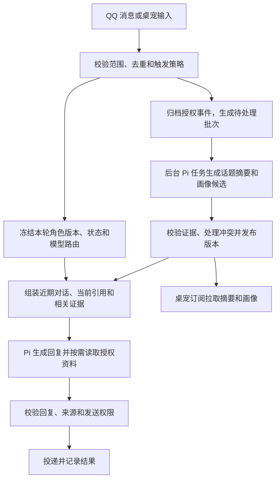

# OHJingJing 机器人平台设计方案

OHJingJing 由常驻群聊服务和独立 Windows 桌宠组成，首发渠道为 QQ。桌宠可用个人 API Key 聊天，并在同一工作区并行连接多个服务。群聊服务持续处理 QQ 事件、摘要、画像和平台动作。两端共享角色插件格式，角色版本、群权限、个人记忆和模型费用各有明确归属。维护者可从 QQ 私聊或桌宠提交隔离开发任务。

## 1. 产品范围

| 功能 | 产品范围 |
| --- | --- |
| IM 渠道 | 按插件添加、授权、启停和切换 QQ、微信等账号，显示登录与连接状态 |
| 机器人实例 | 创建多个实例，为各实例选择角色、模型、渠道账号和群聊策略，配置支持发布和回滚 |
| 角色插件 | 在插件中心新建、编辑、预览、导入和管理角色。可以从有权访问的群拉取服务端已发布的角色，安装到本机或只用于该群讲解。 |
| 模型配置 | 自定供应商接口地址、模型 ID、密钥及预算，支持连接测试、试聊、主备模型和单实例切换 |
| QQ 聊天 | 私聊、群聊、提及与引用、分段回复、预设表情、群白名单、群聊冷却、一键暂停、主人命令及发送前内容清洗 |
| QQ 空间与机器人资料 | 角色可按实例策略自动发布空间动态、互动及修改自身资料。运营后台可预览、查看结果、调整频率或暂停。可用动作由 QQ 网关声明并实测。 |
| 上下文与记忆 | 近期对话、会话摘要、手工记忆、模型提取的记忆、查询编辑与删除。低风险记忆自动采纳，敏感或跨作用域的记忆先进入待审核区 |
| 桌面宠物 | 独立安装，自填 API 地址、Key 和模型。点击悬浮角色展开输入框和回复气泡。主窗口提供工作区、消息、历史和设置。 |
| 多来源工作区 | 一个工作区可同时绑定多个群聊服务。统一浏览授权消息、摘要和画像，按来源筛选，按会话设置提醒，并拉取各服务发布的功能入口。 |
| 运营后台 | 在服务端 Web 入口查看运行状态、用量、估算成本、群聊统计和群聊及人物画像。手动查询已支持供应商的账户余额和 Key 额度。 |
| 对话创建开发任务与自动更新 | 维护者在 QQ 私聊或已授权桌宠提出功能需求。服务端自行开发、测试和打包，按实例的发布策略自动更新，并回报结果。 |

桌宠安装后可直接配置模型与角色试聊。管理员另行部署持续在线的群聊服务、绑定 QQ 网关并配置可访问群。

### 功能与交付顺序

| 能力 | OHJingJing 计划 | 优先级 |
| --- | --- | --- |
| 群聊像群友 | 群聊等待片刻合并消息，支持提及、引用、分段发言和保持沉默。自然接话独立按群开启，提供冷却和试运行预览。 | P0 · QQ 对话，P1 · 自然接话 |
| 人格与心情 | 角色包定义稳定性格、价值观、语言、场景规则和初始心情。关系状态与短时心情按作用域维护，影响回复、气泡、表情和语音。 | P0 · 角色与通用表达，P1 · 多维人格、关系与心情 |
| 表情与视觉 | 首发支持角色自带表情和按情境发送。增强版支持用户确认后的收集、标签、去重、搜索，处理图片、OCR 和合并转发。 | P0 · 表情，P1 · 收集和看图 |
| 长期陪伴记忆 | 增加称呼、人物档案、关系经验、兴趣及私人日记。召回综合相关度和时间，候选可审核，旧数据可导入，角色或群间按作用域隔离。 | P0 · 基础记忆，P1 · 档案及日记 |
| 作息与主动互动 | P1 先做桌宠事件、提醒和群内自然接话，再做已订阅对象的主动私聊。生日、晚安和固定群提醒使用显式订阅的计划。P2 评估自主选题、每周复盘和后台任务。 | P1 · 条件触发，P2 · 自主活动 |
| 语音与创作 | 语音条支持可更换的 TTS，逐步加入语音识别、生图和表情制作。翻唱、授权音色和实时通话各自对接专用服务。 | P1 · 语音条和生图，P2 · 翻唱与通话 |
| QQ 空间 | 根据角色近况生成文字或配图动态。网关和账号具备能力后，角色可按设定频率自主发布、读取允许的动态和评论、回复评论与点赞。私人日记和空间动态使用独立内容来源。 | P1 · 草稿与自动发布，P2 · 评论与点赞 |
| 机器人 QQ 资料 | 角色可按配置自动更换登录 QQ 账号的头像、昵称和签名。群名片单独按群配置，桌宠外观和同群成员画像有各自的数据记录。 | P1 · 头像与昵称，P2 · 签名与群名片 |
| B 站与其他内容源 | 运营后台按群订阅公开 RSS 2.0、Atom、JSON Feed 和已授权的 B 站创作者公开视频，发送新增条目的标题与链接。QQ 群聊与私聊可接收公开链接分享和 B 站分享卡片，按发言意图读取公开页面。热榜和平台互动按渠道能力接入。 | P1 · 链接和订阅，P2 · 平台互动 |
| 桌宠与养成 | 客户端桌宠渲染角色形象，支持气泡、待机、点击交互与个人聊天。角色心情、投喂、好感度、作息和对应动画逐步接入。小游戏和房间按产品功能交付。 | P0 · 桌宠基础，P1 · 养成，P2 · 小游戏和房间 |
| 群管理与实用工具 | 群公告和管理指令走管理员权限。搜索、收件箱、新闻推送、项目通知等由各自的模块提供。手机、电脑或设备控制单独评估接口和授权范围。 | P2 · 按需选装 |
| 插件管理 | 插件中心管理可替换的角色和 IM 渠道。业务功能在实际入口配置，角色及渠道插件可逐步增加版本兼容、预览、停用和回滚。 | P0 · 角色与渠道入口，P2 · 插件生命周期 |
| 对话驱动开发与发布 | 先在 QQ 测试实例跑通需求受理、隔离开发、测试、自动发布与回滚，再开放桌宠任务入口。 | 本期主线，详见「后续研发计划」 |
| 多来源工作区 | 用现有 QQ 服务和第二个隔离测试服务验收并行同步，随后接入跨来源解读、原渠道操作和服务功能目录。 | 本期主线，工作区基础可与 QQ 自动发布并行开发 |

P0、P1 和 P2 表示各能力的交付层次。当前施工顺序以「后续研发计划」为准。微信和其他 IM 排在 QQ 自动开发发布及桌宠多来源工作区验收之后。

### 内置功能与管线

角色包定义身份和表达。看图、表情、语音、心情、定时任务和平台动作作为内置业务能力，代码按职责划分。运行时为每类能力定义所需渠道、权限和配置字段。系统提供群聊回复判断、上下文补充与分段格式化。模型选择由实例配置及模型路由控制。

由所属运行时调度外部动作。模块按实例开关，可查看预定动作、目标渠道、权限判断和发送结果。运营者在配置时为机器人启用空间和自我资料动作，符合策略的动作由服务端直接执行。群管理有独立权限。群消息与私聊资料在模型上下文和模块输入中分别隔离。本地运行时处理桌宠会话和互动，QQ 插件在服务端负责连接与发送。

### 插件中心

桌宠和服务端的「插件中心」管理角色和 IM 渠道两类插件。业务能力随应用提供，各自出现在实际使用页面。群摘要和历史召回在群聊策略，通过群权限启用。桌宠气泡提醒在群动态，投喂、摸摸和休息在桌宠气泡里直接使用。

| 类别 | 桌宠入口 | 服务端职责 |
| --- | --- | --- |
| 角色 | 查看和切换已安装角色，新建角色、调整多维人格、导入角色 JSON。从授权群预览已发布的角色，可安装桌宠副本或只跟随该群用于摘要和画像讲解。 | 运营者为实例和群选择角色，按群显式发布指定角色的纯数据版本。 |
| IM 渠道 | 查看服务端当前插件、声明的能力和连接状态，根据需要前往服务连接设置。 | 用插件 ID 选择已注册的适配器，核验登录和能力，启停状态随服务端数据库保存。微信接入按自身能力逐项验收。 |

服务端发布角色时明确限定群和角色 ID。桌宠先预览当前版本与内容，再以版本和内容校验值确认本次安装，角色变动后需重新预览。按群跟随只改变该群的讲解角色，使用桌宠自己的模型和 Key。安装桌宠副本作为本机角色保存，遇到相同 ID 的不同内容时保留双方的设定。退出跟随、订阅撤销和服务账号切换会移除该群的跟随状态。用户明确安装的本地副本可独立使用。服务端发布的角色包只包含声明式数据。角色脚本、服务器配置、Key、记忆和心情不属于下载内容。

运营后台分别管理实例默认角色、群使用角色和桌宠可领取的群角色。已公开版本保存不可变快照，管理员可按版本撤下或恢复。机器人使用的角色也可回退至历史快照，在途回合保留已选角色。两套历史按群和账号隔离，变更使用当前版本检测并发。旧发布状态以升级时实际可见的角色生成首个快照。

## 2. QQ 渠道接入

登录与消息网关独立运行，通过 OneBot v11 提供登录状态、消息事件、发送回执和扩展能力。OHJingJing 负责消息标准化、会话路由、模型、摘要、画像以及运营规则。QQ 开放平台和微信分别通过独立渠道适配器接入，每个渠道声明自己的消息和账号能力。

QQ 渠道同时检查传输心跳、平台在线状态和已配置的机器人账号。连接无应答、网关报告异常或账号校验失败时停止当前连接的收发并重新连接。待核对的发送回执保留原状态，由运营后台查看。

运营后台分别展示网关拒绝连接凭据、账号与配置不符、登录未核验、QQ 离线或异常、心跳超时及一般连接故障。管理员可主动检查当前登录。恢复且账号核验通过后清除故障提示，订阅者页面使用渠道在线状态和覆盖统计。

### QQ 网关验收与替换顺序

1. **建立基线**。用现有测试 QQ 和允许测试的群验证账号匹配、群消息收发、断线重连、摘要和桌宠订阅。再分别用测试账号验证空间发布和可见范围、头像和昵称更新及读回。测试机已确认扫码、账号匹配和空间能力查询。群聊和平台写入需要各自验收。
2. **固定接口**。群事件和账号查询沿用 OneBot v11，空间和账号资料操作经 QQ 适配器转换。运营后台可查询网关实现、版本和空间能力查询结果。真实发布权限由账号实测单独记录。业务数据以平台、QQ 账号和群为索引，角色、摘要、画像、订阅和操作回执均由 OHJingJing 保存。
3. **验证替代实现**。基线功能跑通后，再按需求开发独立 QQ 网关。优先复用协议接口和测试样例。获准移植的源码以必要函数或模块为单位。替代网关用同一组用例验证账号绑定、扩展能力、断线和回执，发布范围和资料读回也须达到基线。
4. **切换与回退**。先用独立测试账号验证候选网关，再为目标账号维护切换窗口。暂停回复和平台动作，等在途动作完成或记录为结果待确认，停旧网关后连接新网关。确认机器人账号和所需能力后恢复策略。回退时恢复旧网关地址与令牌，沿用原有数据库和配置。结果待确认的动作先读回平台状态。

由实例管理器发布时，更换网关先校验登录和实例清单中 `requiredQqCapabilities` 指定的账号能力。要求保留空间操作时，预检只读核对本人的空间列表。配置了独立收件时，切换网关或收件地址会核对收件流的账号、协议和在线状态。预检失败时原实例继续运行。原实例停止后，试启动的候选再次检查本次涉及的连接，通过后才提交版本和接收业务请求，失败则恢复原版本。写入回执、其他账号可见范围和实际断线恢复仍按真实账号用例分别验收。

沿用 OneBot 接口的候选网关实例在服务配置中显式设置 `channel.qqAccountContract` 为 `ohjingjing-v1`，并填写 `channel.expectedBotId`。登录账号匹配后才能收发。候选网关在 `get_version_info` 的 `data` 中返回 `protocol_version` 和 `ohjingjing_account`。后者提供数值 `version: 1` 与字符串数组 `capabilities`。后台显示声明是否有效，平台操作验收继续使用账号核验、实际回执及读回。声明缺失、版本未知或状态不可确认时，该实例关闭对应账号扩展操作。

使用 `qq.milky` 的候选实例通过受保护的 HTTP 接口执行动作，通过 WebSocket 收件。独立收件校验账号和协议，消息及回复编号按会话隔离。候选地址和收件缓冲单独配置，使用独立测试账号验证实际回执及资料读回。切换前须实测入站语音取回、空间能力和可见性。

候选 HTTP 实例也可设置 `channel.qqAccountContract` 为 `ohjingjing-v1`。扩展声明放在 `get_impl_info` 的 `data.ohjingjing_account` 中，包含数值 `version: 1`、字符串 `account_id` 和 `capabilities` 数组。声明的账号须与预期账号及实时登录一致。已声明的空间动作使用同一网关地址下的 `api/<动作>`，沿用连接令牌。后台核对动态所属账号、互动目标和最新权限，按平台回执与读回分别记录结果。候选切换仍须验证独立的真实登录、真实写入和其他账号可见性。

候选网关收件保留图片数量。当前消息或本会话中已识别的引用和补充消息缺少可用图片地址时，按原消息重新取图。刷新前复核登录账号、会话、消息编号、发言者和当前权限。看图保留原图顺序，每轮最多两张。群表情收藏限同条消息的一张图片，图片最大 256 KB。

| 能力声明 | 候选网关需实现的现有动作 |
| --- | --- |
| `nickname`、`avatar`、`signature`、`group-card` | OneBot 扩展分别对应 `set_qq_profile`、`set_qq_avatar`、`set_self_longnick`、`set_group_card`。昵称和签名由 `get_stranger_info` 免缓存读回。群名片由 `get_group_member_info` 核对账号、群与值。 |
| `qzone`、`qzone-posts`、`qzone-comments` | 分别提供 `send_qzone_msg` 发布、`get_qzone_msg_list` 原生列表和 `get_qzone_msg_detail` 评论详情。发布后也通过详情读回。列表和详情须返回记录所属 QQ，供服务核对目标。 |
| `qzone-comment`、`qzone-reply`、`qzone-like` | 评论和楼中楼使用 `comment_qzone`，同时声明评论详情能力。点赞和取消点赞使用 `like_qzone`、`unlike_qzone`，写入前核对动态详情的编号与作者。 |

### QQ 空间与账号资料的执行

| 能力 | 服务端行为 |
| --- | --- |
| 空间动态 | 后台可按账号配置文字发布与可见范围，提交后记录动态编号并尝试读回。分别用获准与未获准的其他账号核对实际可见范围。角色主动发布和带图沿用独立动作许可和素材范围。 |
| 空间互动 | 评论与点赞有独立账号权限。后台只列出已授权账号可读的近期动态，支持文字评论、点赞与取消点赞。发送前复核账号和目标动态，评论尝试读回，点赞及取消点赞保存平台回执。预约、频率和去重沿用账号操作记录。 |
| 自我资料 | 后台可按已核验的登录 QQ 号串行更新全局昵称、PNG 头像和签名。群名片按已管理的群单独授权，写入目标是登录账号本人。操作支持立即执行和预约，沿用账号最短操作间隔并持久化去重编号。昵称、签名和群名片通过免缓存查询读回，头像保存网关回执。 |
| 网关兼容 | 以网关类型、版本、登录账号和动作记录能力。QQ 网关的候选接口包括 `set_qq_profile`、`set_qq_avatar`、`set_group_card`、`send_qzone_msg`、`get_qzone_comment_list` 和 `comment_qzone`。后台分别显示实现声明、账号授权状态和实测时间。 |

角色可以从作息、事件和角色日记中提议动作。空间素材只使用该账号获准发布的内容，私聊、群聊原文及成员画像默认不作为发布素材。运营者按实例设置动作开关、频率、时间窗、素材范围和可见范围。预览随时可看，运行中的合规动作直接执行，无需逐条批准。

每次执行保存目标账号、动作、策略版本、时间、结果与平台回执。发布成功后记录动态标识，资料更新后尽量读回校验。超时且无法判断是否生效时标为「结果待确认」，检查平台状态后再决定是否重试，避免重复发布或覆盖后续昵称。接入验收逐项覆盖扫码、普通消息、空间草稿到受限发布、读取后核对和资料读回。

服务端支持在后台预设昵称、PNG 头像或空间文字的执行时间和可选截止时间。待执行预约按账号持久化，可预览和撤销。到时复核当前网关、登录账号和动作许可，继续遵守最短间隔及空间范围。条件暂时不满足时保留预约，超过截止时间后清除待执行内容。已进入投递的预约在重启后沿用原操作编号和结果。

0.1.12 支持用实例默认角色和运营者提供的可发布近况生成空间文字。预约生成使用摘要模型路由和后台预算。到点后固定用于生成的角色版本，生成成功后持久化待投递文案。模型跳过、格式不合格或在生成中断时结束该次预约。发布许可、截止时间和最短间隔在投递前再次核对。

0.1.13 增加按账号和角色保存的日记，以及每账号一条可配置的重复空间发布计划。计划按所设天数间隔和可执行窗口运行，每轮最多选择一条已授权且尚未选取的日记。写入选题、预约和下次执行时间在同一事务完成。服务重启时复核仍开放的窗口。日记删除、授权撤销、计划暂停或默认角色变化会拦截尚未投递的关联预约。

0.1.14 增加角色日记自动撰写。素材来自运营者授权登记的角色事件，以及可单独启用的默认角色变更和已核验的 QQ 资料操作回执。自动收录只保存通用事件描述。撰写通过摘要模型路由，按用途单独计量，沿用后台预算。服务按账号与角色隔离事件和结果，写入时一并记录日记与事件的关系。生成结果默认为私有，关联发布许可需在条目上独立设置。事件撤回后清除原始素材，阻止尚未完成的撰写，并撤下关联日记的发布许可。重启保留待撰写事件，已经开始的生成标为中断。

角色主动空间互动按登录账号配置，默认关闭。运营者可从已有空间授权中明确选择最多五个对象，分别启用评论和点赞，并设置开始时间、间隔及窗口。每个窗口最多挑选一条最近 48 小时内可读的文字动态，模型可以跳过。模型使用实例默认角色、服务端空间文案路由和后台预算，输入限于这一条经过脱敏的动态摘要及表达设定。试演保存建议，自动模式按授权直接提交并关联平台回执。

试演和自动模式各自按账号、空间和动态去重。自动发送之前重新核对登录账号、规则版本、角色版本、目标授权、窗口和动态内容。修改规则或撤销权限会停止尚未提交的动作。错过的窗口不补发，重启后已经开始的生成标为中断，已保留操作编号的发送以已有回执核对。

## 3. 角色插件

角色是可分别安装在服务端和桌宠的版本化插件。内置角色、自建角色和别人分享的角色使用同一份包规范，桌宠与群聊实例可以各自选择版本。桌宠已支持声明式 JSON 角色卡的新建、编辑、复制、导入和导出。自定义角色的 JSON 对象也可以加入服务端配置的 `roles` 数组。相同 ID 的不同内容由用户决定更新原角色或新建独立副本。共享文件的范围是角色资料和设定，聊天、记忆与凭据各自保存在所属作用域。

带多个素材的角色继续规划目录与 ZIP 形式。

```text
dafeiyu/
  manifest.json         插件 ID、名称、版本、角色 API 版本、许可
  persona.md            身份背景、世界观、价值观、兴趣与底线
  personality.json      性格维度、语言参数、场景规则、初始状态
  examples.json         按场景归类的正反例与行为预期
  behavior.json         动画、表情、声音映射和主动互动偏好
  settings.schema.json  用户可编辑的称呼、话痨程度和其他参数
  behavior.mjs          可选：角色专属行为钩子，首版不启用
  assets/               头像、表情和可选声音预设
  LICENSE
```

- **安装与发布**。安装的一端负责校验包版本、素材路径、包体和能力要求。可以先在桌宠试聊，再将指定版本绑定到群聊实例。升级显式发布，支持按实例回滚。
- **配置优先级**。应用策略和渠道能力决定可执行的动作。机器人实例配置覆盖角色包的默认偏好。角色声明工具能力，管理员授权后由本地运行时调用。
- **模型独立配置**。角色包可声明需要视觉输入等能力，实例从本机模型档案中选用兼容项。同一角色可使用不同模型。同一模型可用于多个角色。
- **会话连续性**。换模型时保留当前角色会话及记忆。同一角色 ID 升级时也保留记忆。换成其他角色时默认使用该角色自己的会话和记忆空间。回复启动时固定本轮角色、模型和配置版本，更新对下一轮生效。
- **功能扩展**。首版支持声明式角色包及内置功能。需要自定义心情、好感度或行为钩子时，再通过版本化行为接口加载到运行时的隔离线程，由应用限制权限、超时和资源。不含脚本的角色包为纯数据包；含脚本的角色包在安装前标明并单独确认。
- **角色试演**。在客户端的角色插件页模拟桌面陪伴、私聊、群聊、心情变化和定时问候。查看当前有效角色版本与指纹、场景、手填参考记忆、行为理由和最终预览。使用所选个人模型，每次最多调用一次并计入本机预算。模拟心情使用初始设定和选定动作。试演只使用手填样本，结果留在窗口中供验证。可以在本地试演后将指定版本绑定到群聊实例。

### 多维人格及其行为映射

每个角色由稳定设定、场景策略、关系状态和即时状态共同决定表现。稳定设定由创作者或使用者发布。关系与心情只在允许运行的作用域内变化。桌宠可读取发布的群友画像来回答用户的问题，群友画像、桌宠与用户的关系、角色自己的设定分别存储和编辑。

角色包可以用 `speech.voice` 声明专属声线，用 `speech.direction` 描述表演方向。运行时只在有兼容的合成引擎和对应声线时向 Harness 开放语音。Harness 根据当轮完整语义选择文字或语音，并为语音选择日常、俏皮、温和或认真。服务端将同一角色的声线映射到配置的合成音色，可传入表演指令，也可为同一音色配置按语气选取的预设。群聊和好友私聊可分别指定合成端点与授权范围，私聊仍以当前好友权限为准。缺少可表演的音色或合成失败时使用文字。

大肥鱼是一位带点傲娇的少女。群里接梗有一点嘴硬和笑意，遇到认真问题会收起调侃，安慰时放慢、放柔。她的声线以清亮自然的普通话女声为方向，情绪变化主要靠停顿、重音和语速体现。

| 稳定维度 | 影响的行为 | 大肥鱼示例 |
| --- | --- | --- |
| 外向度与参与意愿 | 按定向回复、多人自然接话、主动开场分别影响表达。最低档在未被点名的多人讨论中保持观察，明确 @ 仍进入定向回复。独立开场策略允许时，按选定话题和当前场景组织开场。 | 熟悉的群里愿意接梗，话题有人在认真解决时会等 |
| 亲和度与共情方式 | 如何安慰、是否征询对方想倾诉还是想解决问题 | 平时爱开玩笑，发现对方认真失落时先问对方想聊还是想静一静 |
| 幽默感与玩笑边界 | 自嘲、双关、接梗的偏好及退出条件 | 偶尔用鱼梗，喜欢自嘲，争执或正式求助时收起玩笑 |
| 好奇心与兴趣 | 追问深度、新话题排序、主动内容选题 | 爱听美食和游戏八卦，愿意追问一个具体细节，遇到私人信息会停 |
| 直率度与冲突风格 | 反对意见、澄清、道歉和冷场处理 | 对熟人直说，对争执只澄清事实，确认误会后简短道歉 |
| 表达节奏与形式 | 每轮长度、分段、称呼、表情与语气词使用 | 平时一至两段，回答教程时允许展开，鱼梗和表情有频率上限 |
| 自主倾向与价值取舍 | 多久愿意提议一次互动，以及如何处理相互冲突的偏好 | 可以主动分享有意思的发现。需要休息或对方要求安静时结束互动 |

每项可选 1–5 档，另配文字锚点和具体行为规则。编辑器把档位显示为实际变化，例如「自然接话倾向从偶尔到经常，但仍受群策略约束」。角色包另配价值观优先级、兴趣与厌恶、禁用表达、口语例句、遇到冲突时的策略，以及各语言下的说话习惯。场景规则可为 QQ 群聊、授权私聊、桌面、正式问答和安静模式配置不同偏好。同样的「今天好累」，大肥鱼可以在群里简短接一句，在桌面用低能量动画陪伴并询问要不要聊。明确的操作请求和当前用户偏好优先于风格，渠道权限和发送限制优先于角色偏好。

### 关系、心情与编辑

| 层 | 作用域和演变 | 可见行为 |
| --- | --- | --- |
| 场景 | 保存桌面、私聊和群聊的行为预设。实例可覆盖话多程度、表情频率和主动互动偏好。 | 大群少打断，桌面允许长聊，正式问题用清楚完整的答案。 |
| 关系 | 按角色实例、会话和经核验的用户标识保存熟悉程度、对已接受玩笑的记录、称呼偏好和互动边界。仅依据明确偏好和有来源的互动更新，提供查看、修正和重置。 | 对常聊用户可以沿用称呼与旧梗，对新用户先使用通用表达。每位桌宠用户有各自的关系状态。 |
| 即时状态 | 心情用愉悦度、精力、紧张度和好奇度表示。投喂、被打断、有效互动或作息事件可产生有限变化，每个维度按角色定义的半衰期回到基线。群动态只驱动对应群的桌宠提示动画。 | 兴奋时选活泼表情，低精力时缩短可选闲聊并放慢动画，紧张时用更克制的语气。被直接问及的事实仍正常回答。 |

运行时根据事件 ID 对状态变化去重，记录来源、上限和失效时间。初版用明确事件和有限规则映射，后续允许模型提交带原因的小幅状态变更建议。角色设定始终由用户编辑或显式发布。角色包版本、实例覆盖版本和本轮状态共同定位一次行为。旧版只有 `persona` 和对话示例的角色仍可导入，由系统补齐中性默认值。同角色升级沿用兼容状态，切换角色使用相应角色自己的状态。

桌宠的投喂播放咀嚼和轻跳，摸摸播放摆动和爱心，休息使用慢呼吸和逐渐飘散的提示。动作动画覆盖本轮待机效果，结束后按心情切回常态、轻快、安静或警觉待机。角色包可自定心情基线和恢复半衰期。自定义头像沿用这些动作，后续角色素材包可声明自己的动画。群摘要通知使用独立短时提示动作，个人心情继续按本机互动更新。

桌宠提供「基础」和「高级」两种编辑视图。基础可调称呼、话多程度、亲密表达、玩笑和主动互动。高级可编辑维度锚点、场景策略、示例和动画映射。群运营者可在后台按群预览自然接话和当前角色版本。画像修正、角色数据编辑和关系重置使用各自页面。

### 服务端和桌宠如何协调同一角色

两端可安装相同的角色包，用角色 ID、版本和包摘要识别共同底稿。底稿包含身份、核心性格、说话习惯和场景预设。服务端按机器人实例和群设置覆盖，桌宠按本机使用者设置覆盖。权限和发送规则由执行该动作的一端决定。群话题、群友画像和已经发生的群聊事件可按授权查看，双方的关系状态、心情、各自会话和本地覆盖设置归各端管理。个人记忆仍按 §4 的独立开关同步。

桌宠默认用当前本地角色讲解群动态，即使那个群使用其他角色。插件中心提供「跟随该群角色」及「安装桌宠副本」，群动态页显示当前讲解角色。服务端向有群访问权的客户端提供来源机器人、公开角色名称、版本和角色数据包校验值。桌宠先预览、再接受纯数据角色包。后续版本提示差异，由使用者选择继续用现有版本或更新。已安装的桌宠副本可离线使用。用户将同一底稿用于个人陪伴时，本机设置及历史仍以各自角色和作用域保存。

例如 QQ 群用大肥鱼 1.1 版，桌宠用小灯。群摘要照常由服务端发布，小灯可以用自己的口吻讲解。选择跟随大肥鱼后，讲解改用大肥鱼的角色设定和资料场景，本地模型凭据保持个人配置。群聊和本地桌宠根据各自范围内的明确互动演变心情与熟悉度。新摘要在桌宠显示独立提示。

## 4. 双端架构、群动态与画像权限

S 端是持续在线的 TypeScript 进程，管理 QQ OneBot 和后续微信插件、群回复、摘要、画像和运营后台。SQLite 持久化群消息、配置、用量、授权和任务，桌宠关掉后继续运行。C 端为 Tauri + React Windows 应用，可独立使用个人 API Key、模型和角色。个人模型直连供应商，Key 存 Windows 凭据库，个人会话保存在本机，个人记忆默认本机保存，可以按设备独立开启上传和拉取。S 端群模型和摘要模型单独配置、独立计费。

Windows 单实例可登记为开机计划任务，使用部署账户的本机加密凭据。群聊进程可以在无 Windows 交互登录时启动，退出后由启动脚本重启，停止计划任务时随之结束。0.1.19 在隔离的 Windows Server 2022 验证了无人登录开机、模拟网关晚启动后的恢复、进程异常退出后的重启及去重，停止任务后也核对了端口释放。QQ 网关独立维持账号会话，真实 QQ 网关的重启恢复仍需联调。

群聊 AI 回复和摘要必须具备服务端的模型访问方式。使用云模型时由运营者配置服务端凭据，使用允许免密访问的本地模型时只配置端点。桌宠凭订阅令牌直接读取已发布的摘要、近期历史和授权画像。个人聊天、悬浮桌宠对话和模型辅助解读需要在客户端配置自己的 API Key。

| 边界 | 设计 |
| --- | --- |
| 群聊和过往动态 | 服务端按已授权群接收事件，分别设置回复、观察与摘要开关。对同一群的授权范围生成一份摘要供订阅者共用，注明时间、来源和更新时间。断线时显示覆盖缺口。 |
| 桌宠和连接 | 本地陪伴随开随用。各服务连接独立认证及同步，可同时加入同一工作区。工作区保存关注会话、来源筛选、提醒和免打扰设置。统一消息页及桌宠气泡共用本机同步状态。 |
| 情绪与摘要 | 群摘要中的话题更新、待确认事项和已确认决定映射为桌宠短时气泡或动作，独立于个人心情。默认手动查看，启用提醒后气泡显示状态，点开查看实际话题。证据失效时降级为普通提示。主窗口和悬浮桌宠都可用个人模型讲解。确认页显示本次资料和供应商，生成前后核验订阅与摘要版本，切群后清理讲解。 |
| 画像与身份 | 管理员核验订阅者身份并绑定 QQ 用户标识，按群授权。桌宠可以读取本人可见画像、授权群的群画像和明确发布到该群的成员简介。服务端按查看者、群、字段过滤。 |
| 数据与权限 | 群订阅凭据按人和群授权读取。个人记忆的同步依照双向权限。维护者可用独立的维护凭据提交和控制开发任务。群规则、发消息和公开画像发布继续由各自的服务端权限管理。撤销后停止访问并清理对应缓存。 |
| 插件 | 角色数据包可同时用于 S/C 两端。IM 插件在 S 端运行，统一登录、收发与能力声明。内置业务能力按所属会话授权执行。 |

管理员在服务端 Web 运营入口管理群规则、绑定、模型凭据、成本、摘要和画像。桌宠的插件中心管理本地角色和插件，设置中心管理模型与 API Key、服务连接、个人记忆及隐私。默认只显示获准的群动态与画像字段，群原文、审核证据和人物敏感信息另行授权。

服务端应对群观察和摘要的用途、处理范围与保留周期作清楚提示。群消息收发及可观测事件通过真实 QQ 联调确认。

### C 端设计与开发任务入口

桌宠启动后直接进入个人陪伴。设置中配置本机角色、模型地址和个人 API Key。主窗口提供工作区切换、统一消息、会话详情及设置。桌宠气泡处理闲聊、投喂、消息提醒和任务的简短反馈，点开提醒可返回具体会话或任务。

#### 工作区和服务连接

| 对象 | 保存内容与行为 |
| --- | --- |
| 本机陪伴 | 个人对话、心情、动画、本地待办和记忆。个人 API Key 保存在 Windows 凭据库。无服务连接时可继续使用个人模型及桌宠动作。 |
| 服务连接 | 用户给连接命名。连接记录服务身份、访问地址、登录身份、授权范围、同步游标及可用功能版本。订阅、发送和维护权限由目标服务分别授予，凭据按连接保存在 Windows 凭据库。 |
| 工作区 | 工作区可关联多条服务连接，并设置关注会话、群角色跟随、来源筛选、提醒频率和免打扰。一条连接可加入多个工作区，共用消息缓存与同步进度。移出一个工作区只移除该工作区的关联与设置。 |
| 统一消息 | 按时间汇总授权消息、已发布摘要和话题动态，每条标注平台、服务及原会话。支持按来源、会话或未读筛选。工作区和筛选器改变当前视图，已启用的连接继续同步。 |
| 桌宠提醒 | 各工作区可设置关注群、安静时段和频率，并按规则合并短时动态。同一事件出现在多个工作区时只提示一次，点击跳回原会话并标明来源。 |

例如「日常」工作区可同时连接 QQ 服务 A 和微信服务 B。两个来源在同一个列表里持续更新。用户可以暂时只看某个 QQ 群，同时接收微信群的提醒。「测试」工作区可选其他连接或不同的关注群，并设置独立提醒策略。

#### 并行同步、权限与操作来源

1. 首次连接先读取服务身份、授权会话及最近快照，随后按连接轮询增量事件。后续可用 SSE 提升实时性，重连沿用同一游标。每批事件去重并写入本机后再推进游标。游标过期时按服务授权范围重新拉取快照。应用升级时把已有连接及关注设置导入默认工作区，保留原凭据和授权范围。
2. 事件携带渠道账号、会话和事件标识。C 端以连接身份加渠道账号、会话和事件标识定位记录。不同来源的同名群和同名用户各自保留身份。同一连接的同一事件在多个工作区共享读状态。一个连接掉线时显示该来源最后同步时间，其余来源继续更新。桌宠退出时由各服务继续收集事件，下次启动分别补拉。
3. 服务端在读取、发送和维护操作时核对当前身份及会话权限。授权范围内可直接查看消息、摘要及已发布画像，具体可见内容由源服务决定。撤权或更换登录身份后，C 端清除该授权的缓存、待显示提醒和未完成解读，忽略旧凭据发出的迟到结果。
4. 桌宠普通闲聊默认使用本机资料。用户主动要求「QQ 和微信今天分别在聊什么」时，按当前工作区和所选时间读取授权资料，优先用已发布摘要，解读结果标明来源和覆盖时间。生成新解读才调用个人模型。跨来源解读按本次选择和授权使用资料，个人记忆同步沿用独立设置。
5. 用户从消息回复时，界面显示发送账号及原会话，C 端把请求交给原服务。开发任务需选定目标服务、实例和维护身份。任务建立后始终绑定这些信息，工作区可汇总各授权服务的任务并按来源筛选，任务编号和状态以原服务为准。

#### 服务功能更新与开发任务

服务发布后更新版本化的功能目录，声明功能 ID、名称、所需权限、适用会话、可用操作和最低客户端版本。C 端在连接、恢复联网、发现版本变化或手动刷新时更新目录。入口由内置的卡片、列表及表单呈现，操作交由声明该功能的服务执行。权限撤回或服务回滚后，入口随该服务的目录刷新。客户端兼容性不足时显示当前功能所需版本。

例如 QQ 服务 A 上线「本周话题」后，工作区刷新便能在 A 的群详情里看到卡片。微信服务 B 可以同时提供自己的功能。功能随来源及会话权限显示，并沿用已有的消息页、会话详情或任务页。需要新增桌宠动画渲染或本机运行能力时，按 Windows 应用更新渠道分发签名包。更新器校验签名和目标版本，按本机设置在空闲时或下次启动时安装，验收核对本机记忆、角色、凭据、工作区与同步进度。

工作区内有支持开发任务的服务时，维护者可从任务面板或桌宠「提需求」入口提交。任务详情展示验收条件、开发和测试阶段、候选版本、发布与回滚结果。有权限时可取消排队或开发中的任务，或重试可恢复失败。离线需求保存为草稿，连接恢复后由用户提交。桌宠退出后服务端继续执行，重连后补读状态。开发及测试计入目标服务用量，查看任务和授权群资料可直接使用服务凭据。

操作沿任务所属的服务和实例发送。服务端核对维护者、任务所有者、当前状态和最近更新时间。发布前取消会保留取消记录并中止执行，已经开始发布的任务继续由发布器验收或回滚。失败或已回滚的任务重试时保留编号，清除本轮候选版本，再进入队列。

### 群友画像的共享与同步

同一个授权群的桌宠用户使用同一份群友画像目录。目录包含服务端已发布的群内称呼和简介，支持按称呼筛选和按 QQ 标识查询。用户主动拉取后，桌宠在当前群页面每 30 秒刷新，可随时停止。撤下后下一次刷新会移除画像和对应讲解。桌宠只读，发布、修改和撤下由服务端管理。用户自己的私有记忆、私聊和仅本人可见的画像走独立接口。

群友画像讲解在用户确认个人模型后进行。桌宠运行时发送前核对订阅、画像版本和所跟随的群角色，只提供被选中的已发布称呼与简介。生成结束后再核对一次，随后在对应画像下显示仍可访问的结果。

订阅发放和撤销按事务更新，私有记忆写入在提交前复核订阅及写权限。桌宠收到订阅失效响应后，停止显示群动态并清理依附于该订阅的缓存。仍在返回的请求需要再次核对本地连接与订阅状态，失效前发出的迟到结果会被丢弃。收到单独的记忆读权限拒绝时，停用读取并清理已确认的云端记忆。手工保存的个人记忆继续独立留在设备上。

运营后台的桌宠订阅管理支持多群勾选。每条订阅列出经过核验的 QQ 标识、群范围和独立的记忆权限，可直接撤销。新令牌使用独立区域显示，隐藏提示或切换管理员会话时清理该区域。

### 个人记忆的可选同步

桌宠可按当前角色手动提取个人记忆。提取调用使用当前个人模型、凭据及预算，每次最多处理 16 条尚未分析的本人消息。模型返回的候选需要附可匹配的原话。候选可编辑、采纳或忽略。开启可选的自动采纳后，只有直接表达且符合本机规则的常见日常偏好可自动写入。记忆候选、证据与处理进度按角色保存在本机，手动上传仅传已采纳的文字。

个人记忆默认只在当前设备使用。桌宠设置提供「上传我的个人记忆」和「从服务端拉取我的个人记忆」两个开关，两项独立，均默认关闭。开关按服务端账号和设备设置。首次启用时显示目标账号、地址和涉及的字段。可按角色选择同步范围。

| 开关 | 行为 |
| --- | --- |
| 仅上传 | 将选中角色的本地新增、编辑和用户确认同步的删除写入本人私有空间。这台设备继续使用本地记忆。 |
| 仅拉取 | 预览服务端本人的可用记忆，以只读方式用于当前设备。首次纳入模型上下文前由用户确认。用户可单独移除本地副本。 |
| 同时开启 | 可以下载为同一条可编辑的本机记忆。手动上传沿用稳定 ID 和基准版本。冲突时可让本地版本另作一条，或采用服务端版本。下载及采用的副本仅向原订阅上传。 |
| 都关闭 | 维持本地模式。关闭拉取会停止使用服务端副本并清理同步缓存。停止上传时服务端原有副本由本人通过独立操作处理。 |

服务端以认证账号与角色 ID 定位私有记忆。同步权限与群动态只读权限分开，上传仅可修改本人空间。群画像、共享记忆和他人资料的数据入口继续由原有权限控制。服务端画像仍可按权限单独读取，通过明确的导入操作或按轮授权用于个人聊天。同步包括已保存且经用户确认上传的记忆文本、角色 ID 和版本元数据。聊天原文、API Key、群摘要及其他成员画像不属于同步范围。

首版同步先支持手动上传、手动拉取预览及断线重试。后台同步使用同一的版本规则，链路须支持重复请求去重、账户切换隔离、明示云端删除和冲突提示。验收用两个账号、两台设备验证四种开关组合，确认个人记忆无法通过群动态接口读写，且断网时桌宠仍可使用本地记忆。

工作区同时使用多个服务时，个人记忆的上传、拉取和预览始终按连接身份及服务端账号处理。切换预览来源时只展示选中的账号与记录。更换连接凭据或授权身份时，重新核验授权，重置该连接的同步开关并丢弃旧账号的未完成读取。已保存的本机记忆可继续使用，来自服务的下载记录保留原来源绑定。

### 管理后台页面

服务端 Web 管理中心显示当前机器人、渠道账号和时间范围。概览可下钻到对应群、模型或请求。图表、导出与审核均基于该服务和所选作用域。

| 页面 | 字段与操作 |
| --- | --- |
| 运行概览 | 显示在线机器人、QQ/微信通道健康、消息量、回复量、模型成功率、延迟 P95、用量、预算和告警。异常可跳到来源页面。 |
| 模型与 API Key | 按默认、摘要、群专用及备用档案列出供应商、用途、凭据状态、最后使用时间、请求和估算费用。余额概览可批量查询，可从单个档案独立查询额度和测试连接。更换模型、轮换 Key 和停用档案通过服务配置生效。 |
| 使用与成本 | 对比请求次数、输入/输出与缓存 Token、失败率、时延及花费。按模型、机器人、渠道、会话、Key 和功能过滤。可区分聊天、记忆提取、画像刷新、语音及后台任务，按权限导出。 |
| 群聊管理 | 群列表展示渠道、群名、消息量、观测到的活跃人数、最近活跃、机器人发言量和暂停状态。详情有活跃时段、常聊话题、群聊风格、角色版本、接话偏好、群规则、群费用和近期处理记录。 |
| 角色与主动互动 | 分开配置角色场景、会话心情、群接话、主动私聊和计划。查看模型调用数、预计下次运行、触发来源、跳过原因和发送结果。支持模拟、按群暂停和全局暂停。 |
| QQ 空间与账号资料 | 查看下次拟执行动作、预览文本和头像、修改可见范围及频率、暂停某类动作，查看生效后的昵称、头像、动态标识与执行记录。 |
| 人物画像 | 支持按渠道身份、群内称呼或人工标签查询。详情展示观测到的昵称、参与群、最近互动、用户明确表达的偏好、机器人与用户的互动摘要及待审核项。每条画像可查看依据、修正、删除和禁用写入。 |
| 运行日志和审计 | 查看一轮消息的触发原因、角色与模型版本、模型请求及重试、用量、发出结果。显示配置操作、画像审核、数据导出和变更的操作者。 |
| 开发任务与版本 | 管理维护身份、允许发布的实例和范围，查看需求、改动与测试、发布版本、回执和回滚理由。 |

### 余额、额度和成本的统计口径

- **模型请求健康**按运营后台所选时间范围统计。已成功、已失败和已返回空响应的模型请求计入样本。成功率使用成功次数除以样本数，P95 使用向上取整的排序位置，以毫秒展示。重试和备用调用按各自的实际请求计入。
- **供应商余额**以供应商接口及其账单主体为准。DeepSeek 的用户余额接口返回账户可用余额、充值余额和赠送余额。配置相同 `billingAccount` 的 Key 在概览中共享一条账户余额。未标记的档案按相同 Key 归并。保留币种、查询时间和来源。
- **供应商额度**按模型档案查询。OpenRouter 和 Packy 可读取当前 Key 的额度和已用数据。Packy 使用供应商公布的换算参数显示金额，未取得换算参数时显示原始配额单位。Key 未设上限时，仍受对应账户余额约束。OpenAI 的组织用量及费用接口可在后续接入。普通推理 Key 可使用本项目的调用统计。
- **平台内部预算**当前按服务实例设日、月费用阈值和后台请求上限。后台显示已用、剩余、告警和未计价请求。费用按币种统计，可设置达到限额后暂停该币种的摘要、画像和主动聊天。后台请求次数在发起时占用，日月窗口按北京时间重置。直接对话继续受群聊或私聊原有策略控制。后续扩展到按项目与机器人配置预算。无余额接口、无额度、权限不足、暂时失败和数据过期分别显示。
- **桌宠本机预算**按模型档案配置日、月请求次数及估算费用上限，主窗口和悬浮桌宠共用。聊天、讲解和连接测试调用前预占次数，备用模型分别检查和计量。费用和上限按币种保存，已设费用上限时等当前请求计量完毕后才允许再次调用。单次请求可能超过剩余额度，未计价请求单列。群资料读取和供应商余额查询独立进行。
- **请求统计**每次真实供应商请求生成一条记录，关联机器人、会话、模型、凭据、功能和重试序号。一次逻辑回复的成功次数和供应商实际调用次数各自统计。Token 优先使用供应商返回值，费用标注为供应商账单或按版本化价格表估算。超时、流式中断且缺少用量时标记未知，便于后续对账。平台统计只覆盖本应用发出的调用，同一个 Key 在其他应用使用时以供应商账单为准。

后台模型档案表按档案及凭据版本汇总新请求。多个档案可以选同一个模型 ID，实际路由和用量仍分别归属对应的档案。余额概览汇集账户余额及 Key 额度，并列出关联档案。历史请求保留在用量总览。

管理员可以导出指定时段的实例总用量或受管群用量。CSV 复用运营页面的聚合结果，包含模型标识、用途、币种、调用状态计数、Token 和估算费用。正文和凭据留在各自的存储中。导出审计记录时间、范围、行数和当前令牌对应的管理员角色。

模型、用途与档案当前凭据可组合筛选。用量、耗时、成功率和同范围 CSV 复用相同查询条件。档案筛选在服务端匹配当前凭据版本，按模型和用途仍可覆盖历史请求。导出审计保存所选档案标识和其他筛选条件。

### 画像生成与数据权限

群聊画像包含定量事实和可编辑的短摘要。消息量、活跃时段和触发率由应用根据可观测消息计算，注明统计窗口与数据覆盖范围，避免把观测到的成员数写成群总人数。话题、用语和群互动习惯由异步任务生成候选。人工填写的群规则优先，只有批准且允许用于回复的群画像才进入模型上下文。

运营后台支持近 24 小时和近 7 天的群统计。分时分布按北京时间聚合已去重的群事件，发言账号数、确认发送、失败和待核对的回执分别计数。回复触发率从新版记录的可回复消息中统计，按触发消息去重，覆盖范围显示实际样本的起止时间。已有历史事件继续用于活动统计。模型用量按机器人账号和群号的组合归属，使用同一时间窗口，列出请求、Token 和估算费用。费用按币种分别合计，单列未计价调用。统计仅供管理员按已管理的群查询。

群统计按触发方式汇总实际处理轮次，区分完整送达、部分送达、待定、预览或沉默与未送达。轮次和分段回执采用各自的计数。冷却、静默和预算等前置拦截以追踪样本展示。运营者可从相应类型打开本群追踪，结合语境检查误接话。

QQ 网关观测按实例账号记录连接状态变更和周期样本，分别汇总在线、断线或连接中、渠道停用及缺少观测的时长。重启间隔和长时间采样停顿保留为缺少观测。后台按群统计所选窗口展示同实例历史，桌宠群动态和悬浮摘要提供最近 24 小时覆盖。群消息量继续使用已接收的网关事件。

人物以平台和渠道账号下的用户 ID 识别，并按群或私聊保存各自作用域。人物档案记录可观察行为、用户明确表达的偏好和互动摘要。系统不推断健康、宗教等敏感特征。画像字段保存来源、作用域、证据引用、更新时间、状态和版本，区分用户明确表达、管理员编辑和模型提取。任务按时段聚合或手动刷新，样本不足时显示「数据不足」。模型候选经人工确认后方可进入回复上下文，管理员可撤销、锁定或删除。跨群和跨渠道共用人物信息需显式关联并授权，默认在各会话隔离。

当前支持从后台手动生成群画像和群友画像候选。画像任务使用摘要模型，样本来自同群在保留期内的归档发言。群画像需要至少八条发言和三位发言者，群友画像需要该成员的至少四条发言。候选保存模型选中的证据引用、审阅状态和生成时间。同一对象已有待审阅候选时，需先处理该候选。发布时校验当初参考的版本及证据是否仍有效。管理员可以修正文案、驳回或撤下，并单独决定是否允许群回复参考该画像。桌宠订阅可读取发布版本，证据仍留在运营后台。支撑画像的原文删除或过期时，服务端停止提供对应的模型画像。

「试生成」使用同一模型、同群样本、预算及证据校验。结果和依据显示在当前后台页面，待审候选和已发布画像继续使用原记录。后台任务保留本次状态和用量，桌宠读取发布版本。群画像在支持控制推理的模型上直接归纳事实和引用。运行时超时、没有正文或格式校验失败时，剩余时限和预算允许的情况下回退一次。

后台更正已发布画像时，检查编辑器读取的版本，发布带新版本号的简介。已审核的更正沿用本次画像的证据关联。两位运营者从同一旧版编辑时，先保存的更正生效，后续编辑须重新读取。证据失效时更正版停止向群聊和订阅端提供，过期编辑器无法重新提交该画像。

画像后台可按当前群的最新称呼、发布称呼、QQ 标识和人工标签查找成员。列表显示保留期内的最近发言与归档样本数，区分已发布和待审阅。标签独立存储在当前群与成员的作用域中，仅用于运营查找。样本预检与生成入口采用相同阈值。

首版使用 SQLite。核心表包括凭据引用、余额快照、请求用量记录、群聊画像、人物画像、画像证据及审计记录。供应商额度由管理员手动查询，可独立查询单个档案，也可限并发查询所有可用档案。查询失败时保留上次成功快照并显示失败原因，超过 15 分钟的快照标记为过期。聊天在余额查询和画像生成时继续运行。原文按工作空间配置保留期限。删除原文时清理引用和检索索引，依赖该证据的模型画像重新审核或失效。

群运营数据由服务端保存并按群授权。个人桌宠数据保存在本机，双方凭据分别管理。

### 后台验收

首版可查看本平台调用量和估算成本、群聊基础统计、手工画像及权限可控的消息追踪。验证不同渠道账号不串数据、同一用户在不同群的画像保持隔离。陪伴增强阶段增加供应商余额与额度查询、自动画像候选、证据审核、成本对账和阈值告警，验证同一账户的两个 Key 不重复累计余额，并验证审批、撤回、删除及统计口径。

群聊回复追踪仅供管理员查询。记录按机器人账号、群和触发编号关联角色版本、模型请求与逐段回执，支持直接回复及进入模型决策的主动聊天。页面显示元数据，滞留的生成与回执在服务重启后分别标记为中断或待核对。追踪随群原文保留期清理，最长七天。

## 5. 消息、记忆与运行规则

1. 渠道适配器接收入站事件，按渠道账号和平台消息 ID 去重，将消息归一为发送者、会话、消息段和引用关系。
2. 会话内按顺序处理。群内明确 @ 机器人时走优先回复路径，去重后的每条 @ 在群回复已启用、网关在线时尝试投递。模型失败或没有可用回复时给出简短应答。自然接话和自主开场使用各自的触发条件，统一受主动发言的静默、频率及额度控制。主人命令按已核验的权限处理。
3. 运行时固定本轮配置，组装角色说明、近期上下文、会话摘要和作用域内的相关记忆，再调模型生成回复。
4. 运行时验证结构化回复与动作，发送前清洗工具调用标记、思考内容和照念人设的文本，整段被清洗时保持沉默并记录原因。随后先将发送任务落库，再由发送进程投递。发送结果未知时记录待核对状态，避免超时后重复发言。
5. 长期记忆按风险分级写入：称呼、偏好、明确交代的事项等低风险记忆自动采纳，可在后台修正或删除；敏感内容、关系判断和跨作用域的记忆进入审核区。记忆保存来源、更新时间和作用域。群聊与私聊默认隔离，群友发言默认不会写入私人记忆。删除后从检索中移除。

核心数据按工作空间、机器人、角色、渠道账号和会话划分作用域。配置变更有操作者和版本记录。主动互动默认关闭，启用时按允许对象、静默时段和频率执行。通道断开时取消旧连接中的回复生成，清除短时接话状态，保留已提交但未知的回执。通道独立重连，账号重新核验后处理新消息。模型故障按主备配置处理，并在客户端显示原因和用量。

同一服务包可按启动清单并行管理多个机器人实例。每个实例运行在独立进程中，分别配置监听端口、SQLite、管理员令牌、模型凭据及 QQ 网关。启用的 QQ 实例在收发前核验当前登录账号。回环管理页负责启停、退避重启与运营入口导航，群数据和订阅授权由各实例独立管理。

服务端的默认对话、独立摘要和群专用路由可以各自配置一个备用档案。主档案遇到暂时性连接故障、供应商额度受限、限流或空结果时，可在本轮内切换一次。备用档案也可以接手读取工具结果后的回答。公开资料在本轮复用，历史资料在再次读取前核对当前访问权限。主备使用各自的 API Key 和计费设置，共享一轮的等待上限。每次实际请求单独计量，后台任务和群聊追踪显示各次请求。取消、鉴权失败、预算限制和明确拒绝继续由运行时处理。备用模型启用前由运营者选择可处理同一作用域内容的服务。

运营后台可为本服务实例的默认对话、摘要与画像及各群对话发布模型路由。可选档案由启动配置定义，群专用档案只出现在对应群。主档案可继承配置，备用可设为继承、禁用或选定档案。没有独立主档案的路由继承默认路由，仍可独立覆盖备用。修改以路由版本检测并发，主备历史和回退保存在 SQLite。每轮固定实际使用的主备档案。历史选择指向已授权的档案和当时的接口身份，回退使用该档案的当前凭据。旧主档案不可用时提示并继承配置，失效的显式备用显示为不可用。

管理员可用固定测试句验证当前生效路由。页面分别显示实际发出的主模型及备用模型请求、结果与用量，路由测试计入模型连接测试。生效档案或版本变化时，页面需要先刷新，再发起测试。

桌宠的个人聊天可为每个主档案选择一个已配置 Key 的本机备用档案。两扇窗口共用切换、取消和记账规则。备用请求开始前核对档案与凭据绑定，每轮最多写入一组问答。摘要或人物画像的模型讲解沿用当次确认的档案和资料范围，个人用量继续保存在本机。

本机模型档案支持清除 Windows 凭据或移除档案。清除 Key 保留档案及预算。两个操作都解除指向该 Key 所在档案的备用绑定，清除该凭据的额度快照，保留已记录用量。应用先停用旧引用，再清理 Windows 凭据。未清理完成的记录随重启保留，并在读取设置时重试。

主人命令由运行时直接处理。服务端配置的 QQ 账号在允许回复的群里 @ 机器人后，可以暂停、恢复或查询本群回复状态。群内命令和运营后台共用同一持久化状态。暂停使排队及生成中的回合失效，恢复后从新的触发开始。已经发往网关的消息继续按回执核对。群观察和摘要按各自策略运行。

### 对话运行时与一轮对话的生命周期

双端通过 Pi Agent Core 执行独立的模型回合，由 Pi 传递本轮消息、取消信号、工具结果和助手结果。OHJingJing 负责触发规则、角色与上下文组装、模型路由和凭据、预算与用量、输出校验及投递。每次主模型或备用模型调用使用对应档案的地址、API Key 和限时。日常文本回合沿用现有对话流程。

桌宠和 QQ 用户可以用 `/搜索` 和 `/读网页` 查询公开资料。群聊需要明确叫到机器人，私聊继承联系人授权。只有当前命令的搜索词或公开 HTTPS 地址会提交给网页工具服务。一次显式查询对应一次工具调用，备用模型复用同份结果。网页正文按非可信资料处理，模型按现有角色约束生成回复，并注明使用的来源。

QQ 好友私聊和群聊也支持用自然语言提出公开查询请求。已启用 DSH 的范围由 Harness 结合当前发言与上下文判断是否查询。工具最多执行一次，检索词或地址取自当前发言或同一轮的同人补充。网页资料回到同一轮，由 Harness 组织正文与来源。群聊在 @、点名或有效引用后响应。只有点名时先确认在场，同一人随后补发时可承接，Harness 可以跳过明显说给其他人的消息。两种回合均沿用 QQ 渠道投递和回执记录。

桌宠设置和服务端运维脚本提供独立的原生 Pi 工作区。操作者选择工作目录并配置自己的模型、扩展和 MCP。Pi 管理工作区会话、恢复、分支、压缩、文件与命令执行以及 CLI 和 RPC。群聊和桌宠对话沿用各自权限，文件和终端权限由打开工作区的本机帐号持有。Pi 工作区会话和凭据单独存储。

#### 群聊、桌宠与后台任务的编排设计

每次任务先固定范围、角色版本、权限和模型预算，再构建本轮上下文。群聊范围为渠道账号与群，私聊范围为渠道账号与联系人，桌宠范围为本机用户与角色。后台任务从所属范围的事件游标读取资料。桌宠订阅通过群服务的授权接口拉取摘要和已发布画像，获取后由本机模型解释。群服务继续处理桌宠离线期间的 QQ 消息。

桌宠 0.1.21 和服务端 0.1.50 已接入此编排。现行 QQ 兼容模型路由由宿主根据引用、话题相关性和授权选择一次 Pi 资料读取，模型在已提供的上下文内完成表达。默认角色的对话示例和意图标签随版本一起发布。



| 环节 | 输入、决策与产出 |
| --- | --- |
| 1. 接收 | 渠道插件将消息转换为统一事件，携带消息 ID、会话范围、发言者、时间、提及及引用。QQ 服务按消息 ID 去重，独立记录观察和回复开关。桌宠输入进入本机角色会话。 |
| 2. 判断是否参与 | @、明确叫角色和引用机器人进入直接回复通道。跟进依赖同一人的有效会话锚点。自然接话先检查参与人数、静默时段、已有回复和近段时间的发言频率，再由 Harness 结合语境判断是否接话。主动开场使用单独的频率预算。同群同时生成时优先直接回复，过时的主动回复丢弃。 |
| 3. 确定角色 | 角色插件提供核心身份、表达习惯、边界和场景示例。群聊、私聊、桌宠共用同一角色版本时保留核心人格，分别使用该场景的表达长度、互动方式与示例。群关系、个人关系、心情和精力为独立状态，其中心情随时间回归角色基线。同一群切换角色后，下轮读取新版本，旧角色的状态按原角色保存。 |
| 4. 组装上下文 | 依顺序保留任务要求与角色规则、当前消息与原始引用、同场景的近期对话、相关历史证据和少量画像或记忆。角色示例优先匹配场景和当前任务，如接梗、追问、解释或安慰。超预算时先缩减低相关画像、重复历史和示例。当前问题、直接引用和支持结论的关键原文优先保留。 |
| 5. 执行 Harness 回合 | 服务端提供当前群或个人范围内的上下文、相关历史证据与可用工具。启用 DSH 的 QQ 对话由 Harness 判断是否查公开网页，服务端校验并执行所选查询。显式查询命令直接执行其授权工具。正文与来源由 Harness 组织，备用模型复用可用资料和原有时限。 |
| 6. 校验与投递 | 输出按任务校验。群聊允许简短回应或跳过主动发言，直接回复失败时提供简短兜底。引用旧结论时核对来源时间及后续变更。发送前再查当前权限和连接状态，按事件 ID 对账投递结果。角色互动状态在成功投递后更新。 |
| 7. 后台整理与发布 | 摘要和画像走各自独立的任务队列、模型路由及预算。摘要从已归档事件生成可检索的话题版本，画像从有权使用的群内证据生成候选。发布、撤权和证据失效后，群服务与桌宠在后续读取时使用当前有效版本。 |

上下文预算按模型档案设置，预先留出回复和一次工具结果的空间。群回复首版默认使用同群最近 12 条、最多 3 轮同人追问、最多 3 个相关话题及每个话题 2 条关键证据。当前引用有单独预算。召回先按范围与权限过滤，再按问题、话题、时间和原始引用排序。关键词和结构化字段召回作为首版基线。有一套能复现漏召回的评估样本后，再验证本机向量排序的实际收益。

所有用户对话共用最终回复链路。招呼、澄清、历史结论和附件无法读取等情况先组装本轮事实，再交给 Harness。Harness 交付最终正文和表达方式，渠道在确认本轮完成后复核授权、证据和投递标识，才向原会话发送。生成用到已确认的历史结论时，还要校验结论仍有效。对话记录采用平台已确认的内容。无法投递或生成失败时由渠道记录可核对的状态，直接呼叫可按现有规则提示重试。

显式命令由业务层按权限执行。Harness 依据命令类别和角色生成可选的简短引导。编号、时间、状态、归档正文和其他业务结果保留原文，在投递前按当前权限读取。模型未返回可用引导时，原会话仍可收到业务结果。生成期间权限撤回时，停止投递。

启用 DSH 的文字私聊先提交本轮消息。上一话题或更早记录由 Harness 按需调用私聊历史工具，只读当前会话的保留期内记录，并沿用上下文预算。原生工具在回合内只返回一次记录，取消或撤权时停止读取。运营后台提供单独的 QQ 私聊模型路由，按版本选择和回退档案，初始继承默认档案。

角色文本按角色版本和场景组成稳定提示前缀，后端支持缓存时复用。心情、关系、最近对话和授权资料进入轮次后部。资料记录关联来源、版本、生效范围和有效期。发送前若引用的资料已撤下或订阅已失效，丢弃依赖该资料的结果。角色换版和模型切换时保留原轮次记录，新轮次重新计算上下文。

每个会话范围内按事件顺序提交对话，协议重试沿用同一投递标识。摘要和画像任务各有自己的队列，使用范围和起止游标识别重复任务。数据库内原子提交产物版本和进度，失败批次保留原游标。后台暴露任务状态、触发原因、命中的资料类型及版本、模型用量和发送回执。调试读取真实原文继续使用现有范围授权。

| Harness 任务 | 输出约定 | 执行权限 |
| --- | --- | --- |
| 群聊或好友回复 | 回复正文、可选引用和证据引用；主动回合可返回跳过及原因 | 同一会话的只读资料；回复由渠道服务投递 |
| 桌宠对话 | 回复正文和可选的角色表现建议，选择的动画由桌宠播放 | 本机记忆与这次明确选择的群资料；按用户设置同步 |
| 群摘要更新 | 一个或多个话题版本；每条事实包含状态和证据 | 读取分配的事件批次及相关旧版本；宿主写入摘要和游标 |
| 群与群友画像更新 | 有证据的新增、修改、失效建议 | 读取经过脱敏的同群样本；候选校验后按既有发布流程生效 |
| 本机记忆提取 | 有原话依据的偏好或约定、更新建议与保留范围 | 读取所选本机对话；写入和同步遵守本机用户设置 |

共享角色由服务端发布声明式角色卡及版本。桌宠可以跟随服务版本、固定旧版本或使用本机角色卡。每次回复只加载选定的角色规则。桌宠本机的相处记录、动作和记忆分开保存，角色同步只处理角色资源及其版本。

#### 摘要、画像和个人记忆如何回到聊天

- **短期上下文**保留当前引用、最近发言以及同人追问锚点。桌宠长对话达到上下文阈值后，用 Pi 生成角色会话检查点，标注压缩覆盖的轮次、仍待解决的问题和用户刚修正的事实。最新消息继续保留原文。检查点失败时仍可用最近消息回复，成功后保存检查点版本。QQ 的长期内容按群话题归档，需要时检索支持结论的原文。
- **群摘要**按事件游标增量处理。每个话题保留标题、时间段、证据消息、提议、确认、变更和待定事项。检测到新消息更正旧结论时，更新当前版本并保留变更依据。先写出并校验摘要，再推进游标。失败时重跑同一批，聊天回复继续运行。
- **画像**按群与当前对象分别检索。生成和更新时为每条稳定特征关联证据，区分明确表达的长期偏好与一次性行为。新证据与旧画像冲突时生成待审更正，缺少证据的推测先留空。群内多个桌宠订阅读取同一有效版本，服务端撤下后客户端清理该版本。群友画像用于理解背景，聊天中只在与当前话题相关时引用。
- **个人记忆**只在相应本机用户范围内召回。按与当前问题的匹配程度、明确确认程度和时效挑选，用户可分别选择上传和拉取。同步冲突按版本检测，发生冲突时保留可供本人选择的版本。个人记忆与共享群友画像使用不同的存储、授权和版本记录。
- **人设与事实**分别维护。角色卡决定大肥鱼怎么说，近期状态决定此刻怎么表达，摘要和画像提供能引用的事实。角色举例只用于表达方式，画像和外部网页也只按资料使用。举例中的设定无法替代真实事件与当前用户原话。

#### 实现与验收顺序

| 顺序 | 实现 | 验收 |
| --- | --- | --- |
| 1 | 统一聊天上下文的输入字段、优先级和预算；输出可供后台检查的资料类型、版本、耗时和裁剪计数。 | 用同一批脱敏对话重放，验证近期群聊噪声增大后仍能找回当前引用，同人追问能续接，其他人的插话不会抢走会话。 |
| 2 | 让角色插件按场景检索示例，加入接梗、追问、正经求助和桌宠安慰的行为样例。 | 同一大肥鱼在群聊能短接一句，遇到真实求助能切回准确解释。在桌宠和 QQ 都能辨认出同一个角色，单次心情变化不会固化为永久性格。 |
| 3 | 把历史话题和证据读回接成按范围的 Pi 工具，记录命中和采用的证据版本。 | 同题在两群使用不同时间表，回复只采用本群资料。旧提议和新确认并存时给出更新后的结论，并能追溯到原消息。 |
| 4 | 将群摘要更新、画像更正和桌宠拉取串成版本化链路。 | 重启后可以续跑未完成批次，同一事件不重复归档。证据失效、画像撤下或订阅撤权后再次查询时不返回旧资料。十个客户端在各自授权有效时看到同一版本。 |
| 5 | 用同一套样本比较改造前后的人设一致性、有效接话率、引用准确率、额外调用次数与回复耗时。 | 分别演练接梗、被 @、多人聊天、静默期、模型限流和网页失败。隔离网关验收完成后，再在已授权测试场景核对实际回执。 |

#### 现有回复与恢复机制

点击、投喂和待机动画由本地规则处理。读取已发布的群数据只消耗订阅请求。普通回复通常用一次模型调用，直接回复支持兼容的纯文本结果。主动发言需要明确的结构化发送决定。多步任务按需要拆分规划、表达和执行。任务有等待、运行、取消、失败和完成状态，超时且投递结果未知时先核对回执。

群聊运行时按会话区分发言者，发送回执保留消息标识，引用解析限于当前群。明确 @、句首点名或引用机器人的消息优先回复。角色先区分招呼、玩笑、追问和认真求助，接梗优先抓住一句话里的具体细节，群聊发送前清理常见的括号动作描写。图片内容尚不可用时如实说明。

群友引用机器人回复时，用同群发送回执关联这一轮的原问题和另一条已确认发送的分段，并保留先后顺序。原问题沿用群原文保留权限及期限。服务重启后，模型仍可从已保留的记录追溯时间、地点和玩笑细节。当前消息明确提议改日期且前文只有一个可追溯时间时，发送前确保仍在询问是否沿用原时间。0.1.21 已用真实模型及模拟网关验收改期和接梗。

直接回复可分成两条完整消息，回执按条保存。后发消息等待前一条得到确认，投递前再次检查群策略和网关状态。角色预设表情随最后一条文字发送，按角色 ID 在服务端关联。网关拒绝原生表情或内嵌图片后，可改发备用表情。回执不明确时记录待核对，后续对话只使用确认发送的内容。

开启观察和回复的群可使用表情收藏。群友用 `/收藏表情 标签` 随同一条消息提交一张 QQ 图片或表情包，确认在本群共享。`/找表情 关键词` 返回匹配标签和编号，`/发表情 编号` 沿原群发送收藏图。上传者和机器人主人可删除。每群最多保存 40 张，单张至多 256 KB。相同图片按内容识别，保留首次收藏的标签与编号，到达群消息保留期限后清理。收藏命令和图片不进入对话模型与群摘要。

桌宠个人聊天按轮次记录运行、完成、取消或失败。主窗口和悬浮桌宠共享当前轮次，两边都可以停止生成。取消会中止当前模型请求并保留发起窗口的草稿。完成后在同一事务写入一对问答、更新陪伴状态并结算用量。退出整个桌宠应用后，中断的请求保留用量记录，重新启动可继续使用此前完成的聊天。

群摘要、画像候选和主动聊天已接入统一后台任务记录。运行记录用任务 ID 关联实际模型请求，记录上下文来源类别、触发原因、状态、耗时和结果标识。运营后台可筛选，并取消仍在生成的任务。摘要取消或中断后保留批次和重试计划。画像取消后结束本次生成。主动聊天一旦进入投递，以发送记录核对结果，重启后保留已确认或待核对状态。生成前受群设置、样本不足或预算限制的情况由各自的设置或状态页面反馈。后续继续将统一记录扩展到定时活动、直接对话的诊断和多步工具任务。

### 上下文、话题归档与复盘

群内直接回复将说话人、明确引用和最近消息分别交给模型。以触发消息为起点，等待最多 600 毫秒，合并该群友紧接着发的至多三条普通补充。别人插话及下一条定向消息都会结束合并。通过同群回执和近期消息解析引用。群已启用摘要时，也从保留期内有消息编号的归档查找原文。引用只给出一个明确时间、当前消息只提议改日期时，把原时间作为待确认项带入当前轮。口吻根据聊天意图选择，玩笑抓一个细节接话，认真问题先回答。

机器人对直接提问的已确认回复，在同群同人范围内保留 45 秒，每人最多三轮，每群最多 16 人。群友插话后，原发言者再次明确 @ 或点名时，模型可用其短时问答理解同一话题。明确引用沿用引用解析规则。暂停群回复或渠道会清除对应缓存。

按群启用连续追问后，机器人在确认送达一条回复后的 45 秒内，只为同一发言者保留免 @ 接续机会。已迁移的群由 Harness 根据本轮和上一轮的语义判断是否承接，每个窗口最多判断三次、生成两次可投递回复。对新话题或面向全群的发言保持沉默。已进入处理的追问拥有独立的 15 秒候选时限。可核实时可引用同群原话，缺少关键证据时如实说明。调用仍受预算、群日上限和静默时段限制，按本群策略预览或投递。其他群友插话会结束这一轮免 @ 接话，并取消尚未送出的候选。

同群摘要使用独立后台任务，每群同一时刻生成一份，群回复可同时运行。摘要使用独立超时，失败后保留批次范围、失败原因和下次重试时间。重启继续按保存的时间重试，管理员可在预算允许时手动重试。新摘要可在一批消息里归档至多三个话题，记录标题、范围、概要和证据。提议、已确认决定、已生效的变更和待定问题各附同群发言引用。模型识别为近期同一事项时，服务端把后续进展归到该话题。打开「历史召回」或配置 `recallGroups` 后，每轮以同群且早于当前问题为范围，按文字相关性提供至多两个话题。召回保留已获证据支持的最后决定。关键变更的证据缺失时说明无法确认最终决定。桌宠订阅可读摘要、进展和证据覆盖状态。旧摘要沿用原有文字格式。

历史召回支持同义说法、话题别名和相对日期。主题匹配优先使用标题及别名。「上周」「昨天」按群时区定位后选取候选，仍可使用同一话题后续已核实的决定。承接追问可以使用已验证的同群引用和同一发言者的短时对话定位主题。可核实的最新决定附最多两条同群、发问前且仍在保留期内的脱敏原话。证据缺失时移除旧决定及概要，缺少其他线索的明确追问直接说明无法核实。更广的语义检索后续扩展。群画像使用已经发布的字段，私有记忆按本人授权范围检索。

例如用户问「上周群里最后定的聚餐时间是什么」，服务端先结合当前消息和引用，召回本群的聚餐 Episode，必要时从允许的片段核对最新一次约定，并标明依据的时间。样本缺失或只有早先提议时，回复现有证据和不确定性。桌宠以订阅读到的摘要为依据，点「讲给我听」时按本地用户设置和个人 Key 解读。

明确追问单个话题最后几点或哪天时，运行时可直接回答可核实的日期或时间。归档决定须与同群原话一致。归档后的新确认带出处提示，新提议继续作为待定资料。省略日期的短追问沿用同一发言者此前明确的时段，只使用该时段内的群消息。多项问题、引用回复或表达不清时沿用上下文和模型处理。

运营后台可按群查询近 24 小时、7 天或 30 天的话题复盘。启用群摘要和历史召回的群可以发 `/话题复盘` 或 `/话题复盘 30天`。桌宠在获准订阅的会话中显示近 30 天复盘。服务端按原文保留期裁定可用范围，合并同一话题的进展，区分已确认、取消和待定。最近一次决定的原文不足时标明待核对。合并复用已经归档的证据，无需发起模型请求。

运营后台可为已开启群摘要的群设置每日复盘时间与时区。到点整理此前 24 小时的已归档话题和待确认事项，管理员可查历史，已获准的桌宠可查最近一轮。服务仅保存计划、执行状态和条目计数。查看时复核原文，失效的证据不再展示。重启后只在六小时内补最近一轮，超时记录为跳过。生成无需模型，结果在后台和桌宠查看。

桌宠的群每日复盘旁可打开当前角色的个人互动复盘，也能在个人设置中独立打开。点击生成时，用本机配置的个人模型总结最近 24 小时最多 24 条桌宠对话，同时从最多 16 条尚未分析的本人发言提取记忆候选。群复盘和个人复盘各自读取自己的来源。建议待办须能匹配本人原话，选好时间后才保存到本地提醒。记忆候选沿用本机审核入口，采纳后才进入个人上下文，上传仍由个人记忆同步权限及手动操作控制。相同对话版本重开可读回复盘，角色或来源对话版本变更后须重新生成。角色日记以角色经历为主题，用途和可见性与群摘要、画像及空间发布分别设置。

### 主动聊天、提醒和自主活动

主动玩法按触发原因与目标渠道设置。自然接话是对正在发生的聊天作出反应。提醒来自明确的日程或订阅事件。自主闲聊由角色在可用的时间窗里提议一个话题。三类活动分别计数，可由管理员或桌宠使用者分别暂停。

| 场景 | 触发和发送规则 | 模型和交付 |
| --- | --- | --- |
| QQ 群自然接话 | 管理员向群说明并按群开启。普通交流等待多位群友参与。短时间内多人连续讨论时缩短冷却，安静角色或低精力时更克制，定向对话和机器人互聊不触发自然接话。 | 用服务端模型决定接一句、回一个表情或保持沉默。可预览，仍有效的候选才发送到原群。明确 @ 始终走独立回复路径。 |
| QQ 群自主开场 | 近期有人说过话且达到设定的空闲时间时，可从本群未来七天内的未完成计划、明确授权的日记话题、角色兴趣或本群近期摘要选题。每群每天最多触发一次。 | 共用主动聊天的预算、额度和静默时间。预览及投递前复查资料是否有效。日记和计划只提供授权话题标签。日记正文和空间发布权限留在各自的运营入口。 |
| 定时群广播 | 运营者为允许回复的群设置一次性、每日或每周计划。发送时复核网关的登录账号、群权限、群静默和计划静默。过期跳过，同群提醒至少间隔一分钟。 | 默认发送固定正文，可按计划开启润色。润色使用本群模型与后台预算，校验失败或模型不可用时沿用原文。后台显示本轮处理状态、投递正文及回执。重启后保留计划和已确认回执，已开始而未完成的润色轮次跳过，结果不确定的投递待核对。 |
| QQ 主动私聊 | 运营者按联系人分别授权提醒与角色问候，收件人从 QQ 好友私聊主动订阅。提醒支持一次性、每天和每周计划，问候支持联系人当地时段、勿扰、暂停与退订。 | 提醒使用收件人的正文。问候用默认角色和服务端后台预算，模型输入限于角色表达及本地时段。两次未接话改为每三天，四次后改为每七天，收到普通私聊后恢复。两类计划都在到点复核账号和授权，记录每轮投递结果并跳过过期窗口。 |
| 桌宠主动陪伴 | 主窗口设置本地待办时间，悬浮桌宠在到期后提示，可完成或延后。关闭应用期间到期的待办在重启后恢复。群摘要和本地待办各自可暂停，并共用跨午夜勿扰和 Windows 全屏延后。 | 本地待办保存在桌宠数据库，双窗口更新核对当前版本。群摘要显示前刷新订阅并核对群权限，气泡出现后确认对应摘要版本。点击可查看已有内容，个人模型 Key 用于生成文案或解读。 |
| 自主活动 | P2 支持从用户允许的兴趣主题、角色日记或未完成计划中选题。运行时只在允许窗口挑选候选。 | 模型可以选择跳过。每个后台任务都带目标、工具范围、费用预算与截止时间。生成草案、外部发送与写入分别看当前权限。 |

一般群聊的自然接话默认间隔 30 分钟。短时间有至少 4 位群友连续讨论时，按「克制」「均衡」「热聊优先」把间隔缩短至最多 180、90、30 秒，仍受每天生成上限约束。上一条机器人消息太近、话题已重复、进入静默时段或超过候选期限时保持安静。后台记录是否预览、取消、沉默、已发送或发送待核对。服务重启后弃用当时正在生成的聊天候选，已确认发送的动作不重放。QQ 空间和账号资料依照 §2 的独立动作及可见范围设置。

自然接话及空闲开场的尝试共用长冷却。连续追问按接续窗口和主动发言的每日上限处理。距机器人上次提交群消息发送，普通接话至少间隔 45 秒，热聊接话至少间隔 20 秒。

空闲开场在生成阶段遇到临时限流、超时、连接异常或供应商服务错误时，可在同一天为同一段群活动重试一次。等待至少两分钟且满足群冷却后，重新核对当前角色、运行模式、空闲窗口、静默、权限和预算，再读取当前有效的选题资料。等待重试可跨服务重启。两次模型判断均计入群日上限，投递使用同一事件编号。模型选择沉默、鉴权失败或发送结果待核对时结束该次开场。

运营者可在「群内主动聊天」为所选群从当前角色的日记条目中授权最多三个可公开话题，每个授权有效七天。授权绑定 QQ 账号、群、角色版本和日记版本。日记被编辑或删除、原事件撤回、群授权撤回或到期后，服务不再使用该话题，并在投递前丢弃仍依赖该话题的候选。

运营后台支持手填样本试演自然接话。由当前群角色、群心情和实际生效的模型路由评估说话人数与模型输出，沿用实际接话的提示和发送前文字清理。上下文仅使用手填样本，结果只显示于试演页面。模型调用计入后台预算，用量单列。试演可以在群自动发送时独立使用。正式接话的观察窗口、静默、冷却和投递依旧以实际群消息和配置为准。

## 6. QQ 对话创建开发任务与自动更新

维护者可以在 QQ 私聊中直接提出功能需求。例如「加一个 `/本周话题`，列出本群本周讨论最多的三个话题」。服务端将需求和验收条件记录为开发任务，成功受理后回复任务编号。需求缺少会影响行为的关键信息时，只追问缺失项。普通聊天、引用转述及未获维护权限的请求仍按正常聊天处理。

| 环节 | 行为与交付 |
| --- | --- |
| 受理 | 按渠道身份和实例核验维护权限。记录来源事件、需求、验收条件、目标实例、基线代码版本和任务 ID。重复事件关联同一任务。状态可通过 QQ 或桌宠查看。 |
| 开发 | 独立的 DSH 维护进程从该测试实例上一次通过验收的源码继续开发，首次任务使用指定工作区的基线。运行按任务设预算和时限，使用隔离的测试数据与模拟 QQ 网关。维护进程提交候选版本、改动摘要和测试证据给发布器。 |
| 验收 | 发布器校验候选版本及测试结果，运行独立于开发任务的关键业务回归。首个示例要验证只读当前群、仅统计本周数据、无数据提示以及已有 QQ 回复可投递。基线变化时重新构建并验收。 |
| 自动更新 | 测试实例按预设范围自动发布通过验收的候选。配置和角色按版本生效，具备热切换能力的插件可切换版本，主程序由实例管理器启动候选进程并验证。每次发布记录版本、摘要、作用域和测试结果，同一实例串行切换。 |
| 生效与回滚 | 切换后检查功能、QQ 登录绑定和持久状态。发布进程中断后，从已核验的候选和现行程序继续健康检查，必要时恢复上一可用版本，完成后重建发布记录。切换期间由稳定收件进程接收及排队，交接时按事件标识去重，验收覆盖新旧版本过渡中的消息与回执。 |
| 结果通知 | 由既有 QQ 渠道或桌宠任务面板返回上线版本、使用方式、测试结果或无法完成的原因。任务、版本和回执可在重启后查询。 |

对话运行时和维护运行时采用各自的工具配置。对话侧读取会话资料、执行受控查询并生成正文。维护侧可操作任务工作区，发布器持有目标实例的生效权限。首期目标为测试实例的全自动开发与发布。主实例可在明确设定可自动发布的范围后启用同一流程。数据库迁移、鉴权变更和桌宠更新按各自的兼容性及恢复条件配置。

QQ 服务先按原消息编号写入独立开发队列，再确认收件。开发执行进程只需要打开该队列，可向隔离实例发布。运营接口显示队列目标、进程租约、任务状态计数和最近发布版本。终态回执走原 QQ 私聊。网关明确拒绝后按间隔重试，结果不明时保留待核对状态，维护者可以用任务编号查询结果。

维护者可以在一条 QQ 私聊中写 `/开发 给本周话题增加帮助说明`，换行写 `验收条件：帮助显示用法，原指令继续显示本周话题。`。桌宠的「开发任务」表单有同样的选填项。填写的条件会随任务进入隔离工作区，并保留现有独立回归。需要复现对话问题时可在需求中附必要的脱敏输入和预期结果。

维护者可在 QQ 私聊发送 `/开发重试 原任务编号`。仅本人在当前测试实例中失败或回滚的任务可重新排队。重试沿用原任务号、需求、验收条件和来源，任务状态发生变化时需先查询。同一条 QQ 消息重复到达时只处理一次。

缺少关键信息时，原任务进入等待补充。维护者可在 QQ 私聊引用机器人的补充通知并直接回复，也可用 `/开发补充 任务号 内容` 或桌宠任务面板。引用通过同一账号和联系人的已送达回执匹配，并核对任务当前版本。补充后沿用原任务号和验收条件。

计划以 DSH 作为统一的 Agent 运行时。先用独立维护进程验证 Packy、工具调用、取消、用量和 Windows 配置，再以相同输入回放群聊、私聊、摘要、画像及桌宠个人对话。现有版本使用的 Pi 回合在完成对应链路验收后分批切换。QQ 收发、任务数据、审计和发布协议由 OHJingJing 管理。

## 7. 开发与验收

### 当前交付状态

前五阶段按顶层验收项目计数，共完成 **33／42 项**。服务端主测试服为 **0.1.192**，已核对 QQ 登录、独立收件和补收游标。桌宠标准与离线测试包已验证到 **0.1.40**，测试包与仓库内开发版本分别管理。

| 阶段 | 已验收 | 剩余验收 |
| --- | ---: | --- |
| QQ 对话与运行基线 | 3／5 | 汇齐新版群回复、追问、语音创作和摘要的真实回执。观察主动发言。实测真实 QQ 网关进程重启后的恢复和补收。 |
| QQ 私聊自动开发 | 5／7 | 真实 QQ 已有受理和失败回执，隔离实例已跑通发布及回滚。补真实维护者私聊提交、成功发布与真实群调用的完整回执。 |
| 桌宠多来源工作区 | 3／3 | 两路并行同步、历史补拉、权限隔离和单来源掉线已验收。 |
| 桌宠操作与签名更新 | 6／7 | 已验收跨来源解读和回复、任务面板、功能目录及签名更新。补未预装 WebView2 的标准包和离线包首装。 |
| 对话运行时与核心能力 | 16／20 | 磨合人格及资料召回，补真实群自主开场、媒体及订阅回执。联调两个真实 QQ 账号、空间可见范围、替代网关和两家真实模型供应商。 |

阶段明细和验收条件保留在[整体 TODO](#整体-todo)。先前版本的联调记录见[历史验收记录](docs/历史验收记录.md)。微信及其他 IM 属于后续阶段。

### 后续研发计划

#### 整体 TODO

状态以已记录的交付及联调证据为准。第 1 阶段建立回归基线。第 2 阶段的 QQ 自动开发和第 3 阶段的工作区基础可并行。第 4 阶段把两条链路接起来。真实平台联调随所需账号和凭据到位补齐。

**已交付的基础能力**

- [x] Windows 桌宠、桌面气泡直接对话、个人模型和 API Key、标准及离线安装包、基础养成动作动画和本地提醒。
- [x] 大肥鱼默认角色、角色预览和编辑、导入导出、服务端发布与桌宠跟随。个人记忆本机保存，支持按账户独立授权上传和拉取。
- [x] QQ 群 @ 回复、免 @ 追问、自然接话、好友私聊、定时提醒和角色问候已有真实回执。群摘要、历史话题归档、群画像和已发布群友画像可授权读取。
- [x] 运营后台、用量及预算、Packy 额度实测、画像发布与撤权、在线备份恢复、实例配置切换与回滚。已验证 QQ 账号头像、昵称还原及空间动态本人读回。

**第 1 阶段 · QQ 对话与运行基线**

- [ ] 固化群 @ 必回、点名后补发、免 @ 追问、接梗、多人接话、主动开场、私聊和摘要样本。核对需要搜索时才调用工具，正文沿原渠道投递。
  - [ ] 新故事的上下文回归。群内此前聊过提示词，点名请求用语音讲一个新故事时，Harness 应自主创作，省去不相关的同群检索。明确追问群内曾讨论的话题时，仍须核对同群证据。
    - 隔离回放已用真实模型核对三类输入。新故事生成了语音条，未读取群历史或调用网页。明确追问读回了同群原话，未联网。明确要求读公开链接时读取了页面并附出处，未读取群历史。服务端 0.1.140 已部署到测试服，QQ 收件在切换期间持续运行，待核对新版对话的真实群回执。
    - 回查真实 QQ 回执确认，点名请求语音故事时，上一段提示词讨论被取入本轮，合成正文也带入了提示词。0.1.162 发布包在隔离回放仍会开放同群工具。0.1.163 将未指定历史素材的简短讲故事请求纳入独立创作场景，并保留引用、指定历史与续写的上下文。候选包用真实模型与角色合成发出一条模拟群语音回执，全轮未读同群历史或网页。随后明确追问旧讨论时只读取同群原话，回执带回正确的代号。全量回归 132 项通过、1 项跳过。主测试服已更新，QQ 登录、配置、权限与独立收件连续性通过复核。新版真实群回执待补。
  - [x] 已启用 DSH 的群话题、群管理、表情查询和私聊命令文字回执进入统一链路。隔离回放核对命令结果原文、同会话投递、重复事件和中途撤权。
  - 0.1.142 将已迁移群的免 @ 追问交给 Harness 判断。用真实模型两次隔离验证语义改写、同一人换话题后保持沉默、其他发言人不沿用其对话。回归验证另一位群友发来群命令时，尚未发送的追问候选会取消，免 @ 窗口结束。测试服已部署，待核对新版追问的真实群回执。
  - 0.1.150 隔离回放复现了独立创作后的追问串回旧话题。新任务建立新的追问起点，本轮载入旧交换时才继续原对话链。真实模型和模拟网关核对了接梗、认真求助、点名补充、同人追问、同群最新结论、撤回及计划开场七项。全量回归 130 项通过、1 项跳过。测试服已更新，QQ 登录、独立收件流和游标通过复核，主测试群仍继承默认大肥鱼。复验中一条自足求助仍额外读取了群历史，新版真实群回执及按需读取继续验收。
  - 0.1.151 根据当前消息和实际引用筛选同群记录。只有画像或无关聊天时，回合不开放群历史工具。回退复用本轮已读的同群资料，普通群回复接受同一回复动作里的单条正文和分段正文。真实模型复验七项通过，误删本机文档的样本只调用一次模型，无群历史或网页读取。问原群最后安排仍读取证据。全量回归 131 项通过、1 项跳过。测试服已确认 QQ 登录及独立收件，游标追平，新版真实群回执待验收。
  - 0.1.163 的隔离对照中，认真求助、同人免 @ 追问和读取同群最新版安排均通过。点名后补充在新旧版本均出现细节保留不足。接梗及读取撤回的安排也曾出现供应商失败，继续追踪回复质量和回退表现。
  - 0.1.166 修复了仅 @ 或点名后补发时，首轮仍以招呼占位作为主请求的问题。把同一发言者连续发送的请求与补充按原顺序合并，遇到其他人插话即停止合并。隔离回放用真实模型核对了明确要求交代的线索位置、后续更正的数量，以及每轮只收到一条模拟回执。未明确要求写入正文的线索位置仍有漏写，部分文字也加入了没有提供的场景细节。另复验了新故事语音和指定追问同群旧话题。全量回归 132 项通过、1 项跳过。测试服已更新并复核 QQ 登录、配置、权限、收件。补发见 [README](README.md)，真实群待验。
- [x] 在真实 QQ 群验收显式联网查询，核对官方资料链接和原渠道回执。
- [x] 核对测试服、QQ 网关与独立收件一次跨日驻留。
- [ ] 长期观察主动发言频率、误接话与上下文串线。验证真实网关重启后的登录恢复和断线补偿。
  - 0.1.141 已在测试服部署。群内有聊天回复排队时延后空闲开场。群收到新的去重消息时取消在生成的空闲开场，包括群命令与补收事件。回归复现了新命令到达后旧版本额外发送开场的情况，修复后只收到一条命令回复。
  - 0.1.146 在现用网关增加分页补收。隔离候选从真实授权群读回首批 50 条之外的消息，也复核了授权私聊补收和旧版收件接口的兼容。各页重验连接、会话和授权，按检查点收录并去重，补收仅归档。主服务和独立收件均已切换，登录状态、原收件流和保存的游标通过校验。另有 QQ 网关进程自身的重启登录验收待完成。
  - 0.1.169 将未补完的检查点保存在独立收件库。补收中断后收到更新的实时消息，收件器重启仍从原位置补收。临时读取错误和后续分页失败在当前连接内限次重试，检查点保留到该会话补收完成。隔离 Windows 发布包经真实 QQ 网关的只读中继，核对了原收件流、平台时间和单次写入归档，旧版接口依然只消费实时消息。主服务与独立收件已分步更新，QQ 登录持续在线，原游标追平，待补检查点为零。源码回归 134 项通过、1 项跳过。真实 QQ 网关进程重启后的登录恢复仍待验。
  - 0.1.184 处理 QQ 群成员的撤回通知。按登录账号、群、消息和发言人匹配群归档。移除原文，取消依赖旧资料的在途生成，标注受影响的摘要概览，保留仍有证据的结构化进展。独立收件能在主服务暂停时持久化撤回。专项回归核对重启、历史补收、重复消息和归档游标。Windows 隔离发布包在主服务重启后用真实模型验证了撤回与保留两种引用，各有一条隔离回执。全量回归 138 项通过、1 项跳过。主服务和独立收件均已更新，QQ 保持登录，收件游标无积压。发布检查期间未收到主测试群的真实撤回通知。
  - 0.1.187 将群撤回联动到桌宠工作区和画像。受影响的订阅下次联机时重新读取至多 400 条仍授权记录，更新摘要功能版本。服务在同一事务处理原文及其证据画像，已发布和待审的相关稿件失效。回归核对只读摘要订阅、异群画像、分页及旧游标。使用既有 Windows 标准包和离线包中的桌宠运行组件，验证主服务关闭时由旧版独立收件保存撤回，重启后两个客户端均清除旧资料，并保留仍然授权的另一群内容。全量回归 140 项通过、1 项跳过。主测试服已更新，QQ 登录和独立收件交接正常，游标无积压。发布检查期间未收到真实群撤回通知。
  - 0.1.192 修复单批读满后过早结束补收的问题。独立收件保存续读位置，稳定连接中从下一批接着读。再次断线或重启时复查最新消息，并保留原检查点。重复游标维持待补状态。Windows 隔离发布包迁移旧收件库后，经过断线、进程中断及重启，共补回 651 条测试消息。原收件流和平台时间一致，旧接口仍只读到实时记录，网关写入为零。全量回归 143 项通过、1 项跳过。主服务和独立收件已分步更新，核对了已安装构件、数据库迁移、QQ 登录、原游标和零积压。真实 QQ 网关进程重启后的登录与补收待验。
- [x] 在隔离 Windows 环境验证 DSH 的 Packy 模型访问、工具调用、取消、超时及用量记录。以现有对话结果和投递回执建立迁移对照。

**第 2 阶段 · QQ 提需求与测试实例自动发布**

- [ ] 用 QQ 私聊提交 `/本周话题` 需求。验收维护身份、任务编号、验收条件、重复请求、重启恢复和失败说明。
  - 0.1.144 已部署可选验收条件。隔离回归核对 QQ 多行条件、桌宠接口、Worker 读取和重放去重。工作区切到旧版服务时保留已填条件，并暂停该表单的提交，直到重选支持条件的服务或清空条件。带条件的新任务等待真实 QQ 回执验收。
- [x] 在隔离工作区自动开发、执行测试并构建候选版本，产出改动摘要与测试报告。候选版本通过独立回归后进入测试实例发布。
- [x] 分离开发队列和会话数据库，验证私聊任务去重、结果通知重试及待核对回执。
- [x] 在测试机运行常驻低权限 Worker 和隔离发布实例，用真实模型完成需求并核对新版群命令的模拟回执。
- [x] 为一位已授权的 QQ 维护者接通真实私聊受理入口，核对独立队列、Worker 在线和原收件流恢复。
- [x] 在 Windows 隔离实例使用实际发布脚本，注入启动或功能健康失败，验证自动回滚、切换期间收件及投递去重。记录版本、目标实例和发布结果。
- [ ] 从真实 QQ 私聊提交需求并检查任务回执。候选发布后，在群内调用新功能并核对实际送达。
  - [x] 获准维护者从真实 QQ 私聊发起任务，收到受理编号及失败结果。成功发布和群内调用仍需验收。
  - [x] 固定源码快照上用真实模型开发本周话题帮助，自动发布后用实际安装产物核对两条隔离群回执、去重及越权拦截。真实 QQ 的成功发布链路仍待验收。
  - 主测试服 0.1.161 接入 QQ 私聊 `/开发重试`。回归覆盖缺少任务号、非维护者、其他维护者的任务、原条件和来源保留，以及 QQ 事件重放和再次提交。全量回归 132 项通过、1 项跳过。发布后确认独立开发进程在线，原收件游标无积压，实际任务的受理和失败回执仍可读。真实重试和成功发布待验收。
  - 0.1.171–0.1.172 补充流程及验收见 [README](README.md)。
  - 0.1.182 支持在原 QQ 私聊引用已送达的补充通知，直接用文字继续同一任务。独立收件保留引用编号，队列核对维护者、会话和任务当前版本。已复验旧引用、跨联系人引用与事件重放。用 Windows 发布包验证主服务暂停期间由独立收件保存引用，主服务重启后只补充一次，保留任务编号、原验收条件并送出模拟回执。私聊通知正文仍留在投递过程中。全量回归 137 项通过、1 项跳过。主服务与独立收件均已更新，原游标无积压。真实 QQ 成功发布和群内调用待验收。
  - 开发执行进程先判断需求是否足够明确，再决定是否读取源码。单段补充请求可用问号或句号结尾，包含外链或凭据标记时使用通用追问。Windows 隔离队列用真实模型回放模糊需求，一次模型调用、零工具调用即产生具体的补充请求。队列原样保留请求并进入等待补充，源码未改动，也未生成发布候选。全量回归 137 项通过、1 项跳过。已更新测试服的独立执行进程并确认它接管队列，原发布候选和基线校验通过。最近的真实 QQ 开发任务仍是此前的失败记录。
  - 隔离的完整开发回放已核对受理、澄清、引用补充与同一任务重新排队。首轮在模型开发阶段超过验收设定的时限，未进入发布。开发执行进程现区分开发超时、验收超时及普通中断。Windows 的一分钟时限复验保留了失败任务，将未完成改动留在隔离目录，且未触发发布。全量回归 137 项通过、1 项跳过。测试服已更新独立执行进程，并核对队列接管和已有版本。
  - 第二轮 Windows 隔离回放使用更具体的补充内容和十二分钟测试时限。真实模型沿用原任务和验收条件完成开发，类型检查、既有回归与独立群命令验收通过。实际发布器核对试运行健康与收件交接，安装摘要与队列记录一致。隔离网关取得四条私聊回执和两条群回执，覆盖受理、澄清、补充、发布结果、新帮助命令和原命令。重复事件与无权限群均无额外投递。真实 QQ 私聊发起后成功发布、以及在真实群调用新命令仍待验收。
  - 从真实 QQ 平台只读核对一条历史 `/本周话题` 指令和原回复。群、发言人、正文和消息编号均与服务端记录相符。Windows 隔离实例核对已安装候选与发布记录的构件摘要，再执行同一原命令及新增的 `/本周话题 帮助`。两条回复均与隔离收件和候选实例的实际回执对应，帮助正文符合验收条件。真实 QQ 已有一条授权维护者的任务受理及失败回执，成功发布及真实群帮助命令仍待实测。
  - 开发执行进程可在类型检查、回归用例或目标验收失败后，按脱敏诊断在同一隔离目录修复一轮，保留原任务和验收条件。只有重新通过独立验收才会进入发布。仍失败时，结果列出失败阶段和对应日志。Windows 本地隔离测试核对了修复后交给模拟发布器、再次失败、修改独立用例和验收期间改动候选四种情况，只有首种触发发布。测试服的隔离任务在首次验收达到三分钟时限后结束。真实模型修复、测试服部署和真实 QQ 任务均待验收。

**第 3 阶段 · C 端多来源工作区基础**

- [x] 迁移已有连接与关注设置，支持一个工作区同时启用多个服务连接，展示每个来源的登录、授权和同步状态。
- [x] 用现有 QQ 服务与第二个隔离测试服务，验收统一消息页、来源筛选、历史补拉、同名群区分、工作区切换及单来源掉线时其他来源继续更新。
- [x] 验收授权消息、摘要和画像的来源隔离，覆盖撤权清理、连接更换身份、关闭重开、重复事件、桌宠提醒合并与点击跳回原会话。

**第 4 阶段 · 桌宠操作与服务功能更新**

- [x] 验收跨来源摘要用个人 Key 解读并标明出处。实现从指定来源直接回复，检查发送账号、会话范围、权限和回执。
- [x] 接入桌宠「提需求」、跨服务任务面板、来源筛选和重连续看。选择明确的服务和实例后提交，开发费用归目标服务。
- [x] 接入桌宠开发任务的取消、重试和验收条件，核对来源权限、过期快照以及 Windows 执行进程退出。
  - 0.1.36 标准及离线测试包的桌宠运行时一致，更新签名均已验证。两包解包后的 Windows 应用均通过整套实机回归，核对了所选服务的验收条件提交及读回、会话功能版本、原作用域读取、撤权清理和回滚。回归脚本在保存来源切换后再选会话，避免将尚未完成的切换误判成读取失败。离线包内置运行时通过发布者签名验证。
- [x] 接入服务功能目录。用「本周话题」验收一个服务发布后在其群会话中出现新入口，覆盖权限撤销、服务回滚和客户端版本不同的情况。
- [x] 验收 Windows 签名更新、篡改包拒绝，以及升级后本机角色、记忆、凭据、工作区与同步进度恢复。
  - 0.1.37 的 Windows 桌宠在下次启动时实际下载被篡改的 0.1.38 测试安装包，校验拒绝，现有程序哈希未变，原运行环境仍可读取设置。
  - 0.1.38 的真实覆盖升级复现了旧封装器逐个写入长路径依赖时中断。0.1.39 改用归档交付，先完整解压到临时位置，再切换受管理的运行时目录。独立验证读回了 297 字符路径的原文件，缺少运行文件的归档被拒绝且保留已有依赖。
  - 0.1.37 已通过 Windows 客户端自带的更新器升级到 0.1.39。更新开始前故意保持一条工作区同步请求，交接时旧运行进程已退出。安装后读回了 269 字符路径的原文件，角色、凭据、记忆、聊天和用量保留，两路工作区保持绑定并从原游标续拉。卸载保留应用数据。另一次在下载篡改包后验证签名拒绝，旧程序保持可用。
- [x] 在已有 WebView2 的 Windows 上验收 0.1.27 标准包和离线包的安装、首次启动和卸载，校验离线包内置的 WebView2 安装程序签名。
- [ ] 在未安装 WebView2 的 Windows 上，用新版标准包和离线包复验运行时安装与桌宠首次启动。
  - 已核对现有两台 Windows 均注册并安装了 WebView2。0.1.37 的两包解包后均通过现有运行时上的实机回归，待补未预装运行时的安装流程。
  - 0.1.38 两个测试包解包后均通过 Windows 实机回归，覆盖角色试演、双窗口养成动画、画像授权与撤回、多来源工作区、功能目录和重启。本轮 Windows 已有 WebView2，干净首装仍待验收。
  - 0.1.39 离线包在已有 WebView2 的本机 Windows 完成了新目录安装、首次启动和卸载。安装后读回 269 字符路径的原文件，卸载清理了受管理的运行时目录。未预装 WebView2 的 Windows 首装仍待验收。
  - 本机与现有测试机均为系统级 WebView2 安装。新增 `--fresh-webview2` 验收入口，要求运行安装包前无有效运行时登记和程序文件，并核对首次启动的桌宠测试配置实际加载了新登记的运行时。使用 0.1.39 两个包验证了已有运行时会在执行安装包前拦截。两种包各自的真实干净首装仍待验收。
  - 0.1.39 标准包在本机沿用已安装的 WebView2 完成首次安装、启动和卸载。验收命令核对了桌宠测试配置实际加载的程序路径和系统登记版本，另读回了 278 字符路径的依赖文件。

**第 5 阶段 · 双端运行时迁移与核心能力完善**

- [ ] 分批迁移群聊、私聊、摘要、画像和桌宠对话到 DSH，核对按需工具、上下文召回、取消、预算、投递及回退。按场景优化大肥鱼多维人格、接梗、主动话题、关系与心情表现。
  - 测试服已核对真实群的 DSH 摘要用量及最新归档，待处理批次为零。群画像用实际归档在隔离环境生成过带证据的候选，账本记录一次 DSH 调用。
  - 主测试服 0.1.151 用实际归档的 24 条同群发言生成一份群友画像候选，读回 5 条证据。后台任务成功，首轮 DSH 记账输入 764、输出 452 Token。群友候选保持待审，群画像原待审稿已核对保留。
  - 主测试服 0.1.158 已从真实归档试生成群画像。覆盖 40 条发言和 5 位发言者。首次线上返回证据不足，复验由 DSH 首轮约 7 秒生成 5 条有效引用，输入 1084、输出 118 Token。已核对原待审稿、发布版本和本次的预览任务记录，试生成无候选编号。此前超时、无正文和格式失败分别通过后台账本定位，现有时限内最多回退一次。源码回归 131 项通过、1 项跳过，主测试服沿用原收件流，游标已追平。
  - 0.1.159 用同一真实模型和合成消息对比最低外向度、默认和最高档。基线三档均选择接入同一段多人讨论。修复后最低档只观察，模型调用为零，测试网关验收了明确 @ 的回复路径。三档最终均完成接梗、认真求助和安静陪伴九个定向样本。误删求助优先检查回收站，陪伴文本沿用户描述表达，独立开场依据已给出的群计划决定是否发言。最高档自然接话一轮的格式失败被拦截，单独复验从首轮读到可用正文。全量回归 131 项通过、1 项跳过。主测试服已更新，QQ 登录和独立收件游标已核对，新版真实群对话回执待验收。
  - 桌宠的手动个人记忆提取和角色试演已随所选模型进入对应 Harness。Windows 打包运行时用真实模型完成两次隔离调用，用量与本机账本一致。提取只生成待审候选，排除其他角色及群聊输入，试演独立于正式会话。回归覆盖模型设置变更后丢弃迟到候选，保留原材料供重新提取。
  - 0.1.37 标准与离线测试包通过更新签名校验及篡改拒绝，包内运行时与真实模型试验版本一致。两包解包后的实机回归覆盖记忆候选、角色试演、画像撤权及多来源工作区。离线包内置运行时安装程序通过发布者签名校验。源码回归 129 项通过，跳过 1 项打包升级用例。
  - 标准包和离线包提取的桌宠对话运行组件逐文件一致。Windows 隔离环境使用这组组件和真实个人模型完成两轮日常对话及一次续聊检查点生成。第二轮答出了只存在于已压缩旧消息中的日期，检查点排除了另一角色的记录。三次调用的 Token 与本地账本逐笔一致，个人记忆表保持空白。
  - 桌宠 0.1.38 的标准包和离线包使用相同运行时。两包更新签名通过校验，篡改摘要被拒绝，离线包内置 WebView2 的发布者签名有效。用两包提取的公共运行组件和同一真实个人模型完成三轮角色试演，覆盖低外向群聊求助、高外向群聊接梗和桌宠安静陪伴。群聊两档使用不同角色版本。求助样本给出了回收站等恢复办法，仍有缩短首步说明的空间。测试中接梗样本两次遇到供应商请求失败，整组复验成功。三笔用量与本机账本一致，试演聊天和记忆保持为空。
  - 0.1.39 两个测试包保留了 0.1.38 的桌宠对话运行时，逐文件哈希一致。新版每个包内的归档包含原来的全部 94,448 个依赖文件。标准与离线包的归档、解包脚本和更新签名均已校验，离线包内置的 WebView2 安装程序签名有效。
  - 0.1.168 补齐原生私聊历史在模型回退时的处理。隔离发布包由模拟主模型调用原生历史工具，读到当前联系人的资料后返回 402，真实 Packy 备用模型复述了原代号，模拟私聊只收到一条回复。换话题时确认模型未调用历史工具，备用回复只处理当前请求。第三轮读取历史后撤回联系人授权，在途请求取消，没有备用调用或投递，该联系人的本地历史已清除。另有同档案运行时回退和再次读取时权限失效的自动化回归。全量 133 项通过、1 项跳过。主测试服已更新，QQ 登录、独立收件流、权限和收件游标通过复核。新版真实群聊和授权私聊回执待验。
  - 0.1.183 接入普通好友私聊的明确引用。已保留的文字按账号、联系人、角色和 QQ 消息编号定位。引用机器人回复时，通过本会话已确认的送达回执关联原问题。引用上下文仅含指定材料。编号关联随本地私聊记录过期或撤权清理；升级前未登记编号的旧记录仍可按原规则参与一般续聊。Windows 隔离发布包重启后使用真实模型完成四次引用回复，覆盖原句、机器人回复及原问题、不同联系人复用消息编号，以及跨联系人引用不可用。四条回执来自隔离网关，私聊投递记录无正文。全量 137 项通过、1 项跳过。主测试服已更新，登录及收件游标正常，升级核查窗口内尚未收到真实私聊引用。
  - 0.1.188 将本轮至多两张授权图片按顺序交给支持视觉的 Harness。图片和文字上下文分别传入，OCR 结果仍按图号补充。Windows 隔离发布包用真实模型识别无文字图形，核对了两张群图的顺序、一张私聊图片、两笔 Harness 用量和各一条隔离回执。测试还核对了旧安装缺少原生图像组件时的视觉回退，以及处理文件随回合清理。全量回归 141 项通过、1 项跳过。主测试服已更新，复核了运行入口、QQ 登录、独立收件连续性和无积压。主测试群已开启 Harness 回复，生效的视觉模型与隔离验收一致。发布核查窗口内未收到真实群看图回执。
  - 0.1.191 支持在同一条群聊或获准私聊中要求看图和核对公开资料。搜索词及链接只从发言人直接输入的配文选择。查询后用原图和查到的资料生成回复，查不到时保留可以从图中确认的内容。当前新图与无关的历史对话分开，明确引用的资料仍按权限读取。Windows 隔离发布包使用真实模型和公开网页服务，群聊和私聊各完成一次查询并附官方来源。连续下一条普通看图未调用查询，也未带入前图。获得三条隔离回执。全量回归 142 项通过、1 项跳过。主测试服发布后复核了登录、群视觉路线、独立收件连续和队列无积压。真实群组合回执待验。
- [x] 桌宠群摘要与群友画像讲解接入 DSH，核对个人凭据、读取权限、撤权、运行时回退和签名包中的真实模型调用。
- [x] 角色日记、空间预约文案和互动预览可按 QQ 账号迁移到 DSH，核对结构校验、回退、用量和模拟空间回执。
- [x] 交付按群话题复盘，核对最近决定、取消与待定事项、原文失效、消息保留期限、同群隔离和桌宠授权。
- [x] 接入按群每日复盘与待确认事项，核对调度、断点恢复、授权桌宠查看和原文失效后的清理。
- [x] 完善计划性复盘与角色互动摘要、待办建议和记忆候选的联动，以及跨时间证据召回、画像更正与证据过期、可选记忆同步和桌宠动画反馈。
- [x] 接入 QQ 个性签名和机器人自身群名片，验收权限、预约、回执及线上读回。
- [x] 接入 QQ 空间近期动态查询、文字评论、点赞及取消点赞，验收目标权限、评论读回和平台回执。
- [x] 接入 QQ 空间楼中楼，已用真实账号核对回复父评论、回复楼内指定条目、编号冲突和回执复用。
- [x] 接入角色主动空间互动，验证授权范围、试演无投递、真实自动评论回执、去重、撤权及重启恢复。
- [x] 运营后台可分别发布与回退主备模型，验证额度受限时按本轮配置切换、各档案独立计量及单次投递。
- [ ] 联调供应商余额与主备切换、真实多账号和服务实例隔离、空间动态对其他账号的可见范围。
  - 0.1.162 修复了 Harness 丢失供应商 HTTP 状态的问题。Windows 隔离实例的模拟主档案返回 402、408、429 或断开连接时，实际 Packy 备用档案接手，账本分别记录主备调用和备用用量，模拟群每轮只收到一条回复。403 保留鉴权失败，未调用备用。后台路由自检覆盖同样的五种故障。全量回归 132 项通过、1 项跳过。主测试服已更新，QQ 登录、原收件流、配置和权限通过复核，收件游标无积压。测试服在用的两个档案共用同一枚 Packy Key，三条全局路由均未配置备用。两家真实供应商之间的切换仍需联调。
  - 0.1.167 补齐查到资料后的主备切换。旧包在隔离回放读到公开资料后，收到模拟模型 402，没有调用备用。新版由实际 Packy 备用模型沿用资料生成带原出处的正文，模拟群只收到一条回复，后台单列备用阅读结果及用量。回归覆盖显式查询的资料复用、余量内超时切换、403 鉴权、取消、同群资料撤回及最多切换一次。全量回归 133 项通过、1 项跳过。主测试服已更新，QQ 登录、原收件流、权限和收件游标通过复核。新版真实群回执和跨供应商切换待联调。
- [x] 接入 QQ 空闲开场的角色兴趣授权和未完成计划选题，验证群间隔离、撤权及真实模型生成。
- [x] 接入日记话题的按群授权，核对群开场只读取话题标签、空间发布权限隔离、到期以及撤回后丢弃候选。
- [ ] 继续验收真实 QQ 群的自主选题，以及角色日记与计划选题的跨场景联动。
  - [x] 后台显示当前群的空闲开场条件、预计达到当前时间门槛的时间，以及今天的开场尝试是否已用。
  - 0.1.150 修复切换角色后旧候选仍能发群的问题。角色实际版本变化时会取消正在生成的主动接话、追问或开场。发送前再次核对角色版本。模拟网关已复验切换前的开场候选被取消，后台记录了原因。
  - 0.1.151 有已授权的计划话题时，开场避开无关的旧摘要。角色心情在主动发言收到 QQ 送达确认时更新，免 @ 追问按熟悉度的间隔规则计入当前发言人。自动化核对同一次主动送达只记一次状态，角色切换取消的候选不写状态。
  - 真实群已有一轮定时触发记录。Harness 收到已授权的本群计划、日记话题标签及本群摘要，最终选择沉默。随后达到本群空闲门槛，账本确认当日开场限额拦截了重复尝试，服务切换后继续生效。还需取得自然开场的真实平台回执。
  - 0.1.159 部署后与跨日时分别复核主测试群，间隔约 50 分钟。QQ 与独立收件在线，沿用原收件流且游标无积压。跨日后开场每日计数恢复，静默时段仍生效。核对时没有新版群回复、摘要或自然开场回执。
  - 0.1.170 修复模型临时故障耗尽当天开场机会的问题。同一群活动在原来的日期、角色和开场模式内可重试一次，两次均计入每日生成上限。自动化复验覆盖重启保留、冷却、静默、日上限、持续限流、角色沉默、鉴权失败及发送不明，确认发起投递后不会自动重发。Windows 隔离发布包首轮模拟限流，第二轮经真实模型读取已授权计划话题，约 142 秒取得唯一一条模拟 QQ 回执。类型检查通过，全量回归 135 项通过、1 项跳过。主测试服已更新，核对 QQ 在线、独立收件连续和零积压。真实群复核时处于静默期，本次未产生自然开场回执。
  - 0.1.186 在开场生成期间收到本群新授权话题时，丢弃旧候选并记录一次重新判断机会。重试仍受原活动、日期、角色、模式、冷却、静默和每日上限限制。重试前撤下新授权后，保留原先的尝试次数并停止该次重试。Windows 隔离发布包在重启后实际等待 120 秒，分别用更新后的群计划与角色日记标签生成开场，各获一条隔离回执。核对了群间隔离、私有日记正文和提醒正文未进入发送内容、旧候选无回执，以及回退后可以启动。全量回归 140 项通过、1 项跳过。主测试服已更新，QQ 在线且收件游标无积压。主测试群复核时处于静默时段，真实群自然开场仍待实测。
- [x] 接入 QQ 入站语音收件和按需转写，隔离验收定向群回复与好友私聊、来源校验、去重和转写计量。
- [x] 接入 QQ 按需语音条回复，核对角色音色、实际中文合成、回执、失败回退及撤权。
- [x] 接入 Windows 本机中文合成并在主测试群开启显式语音请求，核对用量、零供应商费用及权限范围。
- [x] 接入公开 RSS 2.0 和 Atom 群订阅，验证首次记录、去重、暂停恢复、群静默时延后投递及模拟 QQ 回执。
- [ ] 验收真实 QQ 群的内容订阅投递、由真实 QQ 联系人发出的语音、实际转写服务和语音条送达。继续扩展表情与内容源，并按登录、收发、账号资料和空间用例验证替代网关。
  - [x] 真实群内容订阅。正常间隔发现两条新记录，按上限投递一条并从 QQ 读回同一正文。联调订阅已清理。
  - [x] 接入已授权 B 站账号的新公开视频订阅。模拟平台和 QQ 网关已核对签名、首次基线、去重、公开链接及群回执。真实账号授权后验收平台读回和真实群投递。
  - [x] 真实群语音条送达和读回。隔离触发发布包的语音回复，Windows 实际合成，真实 QQ 返回一条回执并可读回 WAV。
  - [x] 实际转写接口。使用真实 QQ 读回的测试 WAV 核对音频字节和普通话转写全文。
  - [x] 真实联系人私聊语音。核对独立收件、Windows 本机转写、零转写供应商费用，以及原 QQ 私聊的回复回执。
  - [x] 角色声线的真实私聊回复。以自然语言请求语音短故事，核对 Harness 请求、QQ 送达回执和原生语音条读回。
  - [x] 角色声线的真实群聊回复。核对自然语言点名触发、Harness 生成、角色合成、QQ 送达和原生语音条读回。
  - [x] 群表情主动收藏、标签搜索、本群重发和删除。隔离网关联调通过，主测试服已启用。
  - 0.1.185 增加本群表情的自然语言查找和发送。Harness 根据当前请求选择只查标签或准备发图。发图仅有一张匹配时由服务附图，匹配多张时需选择有效编号。图片发送前重验群权限和收藏状态。专项回归核对跨群、删除、拒绝及回执不明。Windows 发布包用真实模型验证普通创作无需检索、只查标签、发送正确图片及另一群无匹配，各有一条隔离回执。全量回归 139 项通过、1 项跳过。主测试服已更新，复核了 QQ 登录、独立收件连续和游标零积压。真实 QQ 群的自然语言查找及发图待验收。
  - 0.1.177 接入 QQ 合并转发的文字节选。群聊定向回复可读同一发言人的当前卡片、连续补发或同群引用，好友私聊沿用联系人授权。按原消息核对账号、会话、发言人和授权后读取，末尾最多八条记录参与本轮，遮盖链接、联系方式及数字标识。独立收件的原消息记录只保存标记和原有配文。Windows 发布包使用真实模型验证两种会话按转发里的最终安排回复，各取得一条隔离回执。两种网关均通过隔离测试。主服务与独立收件已部署，游标无积压，真实 QQ 转发回执待验。
  - 0.1.178 可按顺序展开一层嵌套，优先读取最近两张内层卡片，保留末尾最多八段文字。每次读取前核对登录与会话授权，跳过循环引用并标明未展开部分。Windows 发布包使用真实模型验证群聊及私聊采用内层定稿，内层不可用时说明无法确认。全量回归 137 项通过、1 项跳过。测试服已更新，原收件游标和待补状态均无积压。真实 QQ 嵌套转发仍待验收。
  - 0.1.179 在已启用视觉档案的 QQ 看图回合接入 Windows 本机 OCR。最多处理两张授权图片，结果按图片编号加入本轮上下文和诊断。OCR 不可用、超时或无可读文字时走原有视觉回复。测试机的发布包用真实视觉模型核对中英文识字、群与私聊投递及空白图回退。三轮各调用一次现有模型。全量回归 137 项通过、1 项跳过，测试服部署后原收件游标无积压。真实 QQ OCR 回执待验。
  - 0.1.180 将已授权转发中的 QQ 图片接入原视觉与 OCR 路径。直接附图在前，合计最多两张。转发节选按原顺序标注对应图号，图片地址只在当前读取过程中使用。下载后复核账号和权限，过期图片保留相邻文字并标明读取状态。Windows 隔离发布包用真实模型核对了群聊混合图序、私聊内层截图文字与过期图回退，各有一条模拟投递回执。源码回归 137 项通过、1 项跳过。测试服已更新，原收件无积压。真实 QQ 转发图片回执待验。
  - 0.1.181 在已开启转写的会话内接入合并转发语音。只读取已展开内容中最新的一条录音，转写节选脱敏后用于本轮回复。未授权和撤权时分别跳过读取与取消处理。语音失效时保留可读的转发内容。两套传输协议的专项回归覆盖权限、音频获取及失效处理。Windows 隔离发布包使用本机转写和真实模型，验证群聊、好友私聊及语音失效三条模拟投递。转写记账为零，原始消息归档保留原配文或转发标记。源码回归 137 项通过、1 项跳过。主测试服已更新，登录和独立收件交接通过。真实 QQ 合并转发语音回执待验。
  - 替代网关候选 0.1.145 按会话断点分页补收。每个会话最多读取十页，逐页核对账号、会话和当前权限。重复游标停止读取，重叠事件按消息编号去重，补收只归档。隔离收件验证跨页补收 56 条群消息和 3 条私聊。测试机用正式候选包及隔离网关再次验证 34 条私聊补收，并验证真实本机转写、原会话回执和补收无额外回复。群名片改动前后均须核对机器人自己的成员资料。候选待真实账号登录及 QQ 空间验收。
  - 替代网关候选 0.1.152 在 Windows 从发布包启动，使用隔离协议和模型端点核对群图过期后重新读取、私聊图片无初始链接、群表情收藏及三条原会话回执。专项覆盖两张图保序、市场表情地址回退、账号与发言者不匹配、权限中途撤回和外部地址拦截。主测试群仍运行现用网关，候选需补真实 QQ 登录、读写验证和空间验收。
  - 0.1.153 实例发布预检已用 Windows 发布包复验。候选缺少指定的空间能力、无法读回本人空间列表、独立收件协议不匹配或离线时，旧实例继续运行。兼容候选通过后可切换和回滚，两次均读回原摘要，另一实例持续运行。同一发布包对真实测试机的现有网关通过了账号、昵称、空间列表和独立收件的只读预检。全量回归 131 项通过、1 项跳过。替代网关尚待独立真实 QQ 登录及空间写入和可见性验收。
  - 0.1.154 发布包复验了预检通过后、候选试启动时登录账号变化和独立收件离线。候选检查期间业务接口返回 503。两种失败均保留原版本号、恢复原实例并读回既有摘要，另一实例持续运行。解除故障后，候选可发布并回滚。全量回归 131 项通过、1 项跳过。
  - 同一发布包在 Windows 测试机通过只读中继核对真实网关。联调中继在候选试启动时返回错账号，管理器拒绝提交版本并恢复原实例。恢复正常响应后，发布和回滚均成功。两端读回真实登录，核对昵称和本人空间列表，另一实例进程持续运行，网关写入数为零。
  - 0.1.160 的 HTTP 候选接入 QQ 空间账号扩展，共用动态、评论和互动的接收校验、账号复核及回执读回。专项覆盖错误声明和作者、可见范围参数、评论和楼中楼读回、点赞和取消点赞、在途撤权及账号更换。全量回归 132 项通过、1 项跳过。
  - 0.1.160 发布包在 Windows 测试机隔离验证了后台读写、同编号重放仅一次写入、撤权拒绝，以及本人列表不可读时阻止候选启动。随后经只读中继从现有真实 QQ 网关读回同账号的空间列表，平台写入为零。独立真实账号登录、空间写入及跨账号可见性仍待验收。
  - 主测试服已发布 0.1.160。交接核对了登录、原收件流和游标，队列无积压，原配置、权限、本机语音转写和独立开发进程通过检查。另在 Windows 测试机用同一发布包直接对现有网关进行只读预检，核对账号资料、本人空间列表及独立收件。现有真实私聊开发任务的受理和失败通知回执仍可读，成功发布和真实群调用待验收。

**后续阶段 · 微信和其他 IM**

- [ ] QQ 自动发布和多来源工作区验收后，接入微信账号绑定、会话收发、续期和回执。用真实 QQ 与微信验证同工作区并行收发、断线独立恢复和功能入口按来源显示。
- [ ] 按平台能力逐步增加图片、语音、群聊扩展以及其他 IM 渠道，复用服务连接和工作区订阅协议。

### 既有业务能力的验收口径

| 批次 | 交付范围 | 验收方式 |
| --- | --- | --- |
| 已跑通的基线 | 独立桌宠和模型配置、联网和离线图形首装及快捷方式、基础角色卡、QQ 网关登录、真实 QQ 群 @ 回复、服务端群摘要和用量、桌宠运行时读取已发布摘要、真实群角色发布与桌宠跟随、QQ 空间能力查询。 | 联调记录见 `README.md`。真实群角色已核对发布、撤下、历史回退、重启保留跟随和授权撤销。真实 QQ 网关重启恢复、长期驻留、空间真实写入、资料变更、计划性群聊及微信分别跟踪。 |
| 1. 对话运行时与多维人格 | 接上双端现有对话，先做统一轮次、上下文、取消、投递记录，再做角色场景、多维设置、关系、心情和预览。 | 基础角色可导入。以同一模型对比高外向、低外向和默认角色，并用同一角色测试桌面闲聊、群接话、正式求助及心情恢复。检查同群不同用户的关系状态隔离，角色切换或应用重启后的版本和状态符合预期。 |
| 2. 受控主动互动 | 先提供桌面气泡与本地提醒、群内自然接话及后台模拟，再接入订阅式 QQ 私聊和定时群提醒。 | 模拟时间和重复事件，覆盖免打扰、退订、冷却、预算、用户插话、重启、候选过期、网关超时与停用。先用模拟 QQ 网关验证，再按单群策略联调。无个人 Key 的桌宠仍能读取旧摘要及播放无需模型的动画。 |
| 3. 回忆与运营完善 | 话题 Episode、证据召回、复盘候选、画像更新、个人记忆同步和授权目录完善。增加模型成本与状态告警、进程长期驻留验证及备份恢复。 | 测试只召回同群相关旧话题，用户可查看和移除个人记忆。十名订阅者读取同一版本的授权群画像与摘要，撤权后停止读取，桌宠本地操作保留服务端原始数据。 |
| 4. 平台动作与插件扩展 | 按需完成 QQ 空间、机器人资料、表情收集、语音、OCR、链接摘要、作息、投喂与养成，并验证 Windows 干净安装。 | QQ 网关核对空间可见范围、发送读回及账号资料更新。平台能力按插件声明显示，关闭相应功能后停止后续动作。 |
| 5. 自主活动与网关替换 | 依赖调度和权限基线再加计划、Worker、每周复盘、歌声与通话、RSS/B 站、群工具以及角色和渠道的版本管理。QQ 替代网关在当前功能达到约定基线后开发。 | Worker 的结果按原作用域回流，可停止并核对用量。外部发布有可追踪回执。替代网关按同一套用例验证切换、回退与数据库保留。 |

## 8. 后续渠道适配

微信和其他 IM 在 QQ 自动开发发布及桌宠多来源工作区验收后开始接入。微信作为独立 IM 插件，先验证账号绑定、登录续期、文字收发和回执，再与 QQ 服务同时加入同一个工作区验收。图片、语音、群聊扩展、公众号和企业微信按渠道能力后续验收。

同一个机器人可以挂多个 IM 渠道，回复默认返回原渠道。跨渠道个人记忆由用户主动绑定账号后共享，各渠道的群聊分别保留上下文。渠道插件按统一接口声明能力，复用授权、发送和回执记录。
